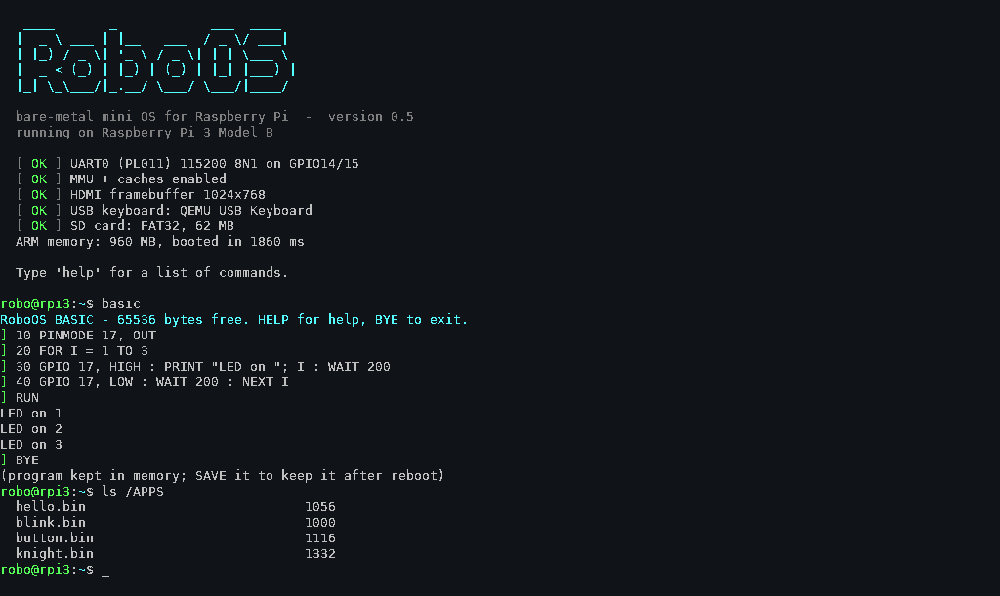

# RoboOS

**English** | [Slovensky](README.sk.md)



A mini operating system for the Raspberry Pi that runs directly on the hardware, no Linux.
You control it with a **USB keyboard** or over a serial line (UART). Output goes to
HDMI and UART at the same time, and both inputs work together.

Current version: **0.15**

## Supported boards

One `kernel8.img` runs on every board with the 64-bit BCM2837 chip; the board is
detected at boot (shown under the logo and in the prompt, e.g. `robo@zero2`).

| Board | Notes |
|-------|-------|
| Raspberry Pi 3 Model B / B+ / A+ | tested on 3B |
| Raspberry Pi Zero 2 W | mini-HDMI; keyboard through an **OTG adapter** on the port marked `USB` (power goes to `PWR IN`); hot-plug works on that port too, with or without a USB hub |
| Raspberry Pi 2 Model B **v1.2** | v1.2 has the BCM2837 (printed on the board: "Raspberry Pi 2 Model B V1.2") |
| Compute Module 3 / 3+ | |

Not supported: Pi 1, Zero / Zero W, Pi 2 v1.1 (32-bit chips), Pi 4 and Pi 5 (different
peripherals, USB behind PCIe).

The ACT LED is on the firmware GPIO expander (3B, CM3), GPIO29 (3B+, 3A+, Zero 2 W - active low)
or GPIO47 (Pi 2 v1.2).

## Putting it on an SD card

1. Format the SD card as **FAT32** with an **MBR** partition table (any size).
2. Copy the whole contents of the `sd/` folder onto it:
   `bootcode.bin`, `start.elf`, `fixup.dat`, `config.txt`, `kernel8.img`,
   plus the folders `APPS` (example programs) and `RUN` (autostart).
3. Put the card in the Raspberry Pi and power it on.

## Programs and autostart

The SD card is also RoboOS's disk (FAT32 or FAT16, read and write).
RoboOS has its own SD driver (the firmware only loads `kernel8.img` and then steps aside).
If the card is not found, `sd init` shows which step failed and the controller registers.

- Everything in **`/RUN`** (`*.bin` and `*.bas`) starts automatically after boot,
  in alphabetical order. Press any key within 2 s to skip the autostart.
- `run <name>` starts a program from the current directory, `/RUN` or `/APPS`; the extension
  is optional.
- Moving around the card: `cd APPS`, `cd ..`, `cd /`, `pwd`; the prompt shows where you are
  (`robo@rpi3:/APPS$`). All commands and BASIC (`LOAD`, `SAVE`, `DIR`) take paths relative
  to the current directory. **Tab** completes file and directory names.
- **Ctrl+C** stops a running program and returns to the shell.

### BASIC - write programs directly on the RPi

```
robo@rpi3:~$ basic
] 10 PINMODE 17, OUT
] 20 GPIO 17, HIGH : WAIT 500
] 30 GPIO 17, LOW : WAIT 500
] 40 GOTO 20
] RUN                      (Ctrl+C stops it)
] SAVE "/RUN/blink"        (saved as /RUN/blink.bas -> starts after every boot)
] BYE
```

- Commands: `RUN`, `LIST [a-b]`, `NEW`, `SAVE "name"`, `LOAD "name"`, `DIR [path]`, `HELP`, `BYE`.
  Typing a line number alone deletes that line.
- Statements: `PRINT`/`?`, `INPUT`, `LET`, `IF..THEN..ELSE`, `GOTO`, `GOSUB`/`RETURN`,
  `FOR..TO..STEP`/`NEXT`, `DIM`, `END`, `REM`/`'`, `CLS`, `RANDOMIZE`; separate statements with `:`.
- GPIO: `PINMODE pin, OUT|IN|PULLUP|PULLDOWN`, `GPIO pin, HIGH|LOW`, `GPIO(pin)`, `LED ON|OFF`, `WAIT ms`.
- Sound: `SOUND Hz, ms`, `PLAY "notes"`, `VOLUME 0-100`, `PLAYWAV "file.wav"` (see the sound section).
- Network: `NETSEND`, `NETOK`, `NETAVAIL`, `NETRECV`; TCP/UDP: `TCPCONNECT`, `TCPLISTEN`,
  `TCPACCEPT`, `UDPOPEN`, `SOCKPRINT`, `UDPSEND`, `SOCKAVAIL`, `SOCKGET`, `SOCKNUM`, `SOCKCLOSE`
  (see the network sections).
- Functions: `ABS()`, `RND(n)`, `MIN(a,b)`, `MAX(a,b)`, `MILLIS`, `MICROS`, `INKEY`, `TEMP`, `CHR$()` (in PRINT).
- Integers only (64-bit). Keywords must be separated by spaces. `.bas` files are plain text,
  so you can also write them on a PC.
- File names when saving: 8.3 (max 8 characters + extension).

Examples on the card: `APPS/blink.bas`, `APPS/button.bas`, `APPS/knight.bas`,
`APPS/ledsrv.bas` (LED controlled over TCP), `APPS/udptemp.bas` (temperature over UDP),
`APPS/sound.bas` (tones and a tune).

### Text editor

`edit <file>` opens a full-screen editor, so `.bas` and text files can be written and
changed right on the RPi (`edit /RUN/blink.bas`, then `run blink`).

| Key | Action |
|-----|--------|
| arrows, Home, End, Page Up, Page Down | move the cursor |
| Backspace, Delete, Enter, Tab | edit (Tab inserts spaces) |
| Ctrl+S | save |
| Ctrl+Q | quit (asks if there are unsaved changes) |
| Ctrl+K / Ctrl+U | cut the current line / paste it above the cursor line |
| Ctrl+L | redraw the screen |

- Files up to 1 MB. New files are saved with 8.3 names (max 8 characters + extension);
  a file with a long name can be viewed but not saved.
- Line ends are kept as they were (CR LF or LF); new files use CR LF.
- On a UART terminal the editor uses the HDMI text size (128x48), so make the terminal
  window at least that big; without HDMI it uses 80x24.

### C programs (SDK)

The `sdk/` folder builds programs in C with an Arduino-style API:

```c
#include "robos.h"

void setup(void) { pinMode(17, OUTPUT); }

void loop(void)
{
    digitalWrite(17, HIGH); delay(500);
    digitalWrite(17, LOW);  delay(500);
}
```

`cd sdk && make` turns every `examples/*.c` into `bin/*.bin`; copy those to the card
(`/RUN` for autostart). API: `pinMode`, `digitalWrite`, `digitalRead`, `delay`,
`delayMicroseconds`, `millis`, `micros`, `print`, `println`, `printf`, `getKey`,
`clearScreen`, `textColor`, `actLed`, `cpuTemperature`, `stopRequested`, `exit`,
`netSend`, `netReceive`, `netName`, and TCP/UDP: `tcpConnect`, `tcpListen`, `tcpAccept`,
`udpOpen`, `sockWrite`, `sockPrint`, `sockRead`, `sockAvailable`, `udpSendTo`,
`udpReceiveFrom`, `sockClose`, `sockError`, `ipAddress`, and sound: `tone(hz, ms)`, `noTone`,
`playNotes`, `soundVolume`, `playWav`
(see `sdk/robos.h`). A program can use `setup()` + `loop()` or `main()`.
Examples: `hello`, `blink`, `button`, `knight`, `chat`, `tcpserv` (TCP server), `udpecho` (UDP),
`music` (a tune and a siren).

Programs are loaded at 0x01000000 (max 16 MB). A crash inside a program prints the
exception and returns to the shell.

**GPIO is 3.3 V** (not 5 V like an Arduino Uno), max about 16 mA per pin.
Use a 220-330 Ω resistor for LEDs and a transistor/module for relays and motors.

## Network: messages between RoboOS boards

The Pi 3B (LAN9514) and the Pi 3B+ (LAN7515) have an Ethernet chip that is a USB device
behind the onboard hub; RoboOS has a driver for both. The 3B links at 100 Mbit, the 3B+
at 1000 Mbit (`net speed 100` limits it; over USB 2.0 the chip moves at most ~300 Mbit). Plug the
boards into the same switch or router and they can send each other short text messages.
The protocol is RoboOS's own, on raw Ethernet frames (EtherType `88b5`), so a PC does
not understand it. For talking to PCs and the internet there is TCP/IP (next section).

```
robo@rpi3:~$ net who
  rpi3-1c2d        b8:27:eb:11:1c:2d  seen 0 s ago
robo@rpi3:~$ net send rpi3-1c2d hello
delivered
```

- Every board has a name: by default `rpi3-` + the end of its MAC address.
  `net name <new>` changes it and saves it to `/NAME.TXT` on the SD card.
- `net who` asks who is on the network. `net send <name> <text>` sends a message and
  waits for the confirmation (3 tries); `net send all <text>` goes to everybody, unconfirmed.
- A message that arrives while you are at the shell prompt is printed as `[NET] name: text`.
  While a program runs, messages wait in an inbox (the last 8) for the program.
- `net` shows the name, chip, MAC address, link state and counters. `net test [seconds]`
  lists all frames on the wire, `net loop on` makes sent messages come back to the same
  board (try things with one board, or in QEMU).
- BASIC: `NETSEND "name", 42` or `NETSEND "ALL", "text"`; `NETOK` tells if the last send
  went through; `NETAVAIL` is the number of waiting messages and `NETRECV` returns the
  oldest one as a number. Example: one board sends its button, the other lights an LED:

  ```
  10 PINMODE 27, PULLUP : REM board A        10 PINMODE 17, OUT : REM board B
  20 NETSEND "ALL", GPIO(27) : WAIT 100      20 IF NETAVAIL THEN GPIO 17, NETRECV = 0
  30 GOTO 20                                 30 GOTO 20
  ```
- C programs: `netSend(to, text)`, `netReceive(from, text, max)`, `netName()`;
  see `sdk/examples/chat.c` (`run chat` = a chat between the boards).

Not available on the Zero 2 W and 3A+ (no Ethernet). The 3B and 3B+ can talk to each other.

## Network: TCP/IP

RoboOS uses [lwIP](https://savannah.nongnu.org/projects/lwip/) 2.2.1 (in `lwip/`,
BSD license), a small TCP/IP stack written for systems without an operating system.
After boot the board asks the router for an address (DHCP) and sends its name with it,
so the router's list of devices shows it under its RoboOS name. When the address
arrives, `[NET] IP address ...` appears at the prompt.

```
robo@rpi3:~$ ip
host:    rpi3-9a4f
link:    up
address: 192.168.1.37 / 255.255.255.0  (DHCP)
gateway: 192.168.1.1
dns:     192.168.1.1
robo@rpi3:~$ ping 192.168.1.1
reply from 192.168.1.1: seq=1 ttl=64 time=0.9 ms
```

- `ip` shows the address; `ip set <address> [mask] [gateway]` sets a fixed address,
  `ip dhcp` goes back to DHCP. The choice is saved in `/IP.TXT` on the SD card.
- `ping <address or name> [count]` - names are looked up with DNS.
- `http on` starts a small web page with the board's name, version, uptime and CPU
  temperature: open `http://<address>/` in a browser. `http off` stops it.
- IPv4 only.

### TCP and UDP in programs

Connections are numbered 1-8 (a program gets a number from `TCPCONNECT`, `TCPLISTEN`,
`TCPACCEPT` or `UDPOPEN`); a negative result is an error: -1 no network, -2 unknown host
name, -3 no answer / refused, -4 too many connections, -5 bad number, -6 closed,
-7 out of memory, -8 port in use. Everything a program opened is closed when it ends.

BASIC (integers only, so data is read byte by byte or as numbers):

| | |
|---|---|
| `H = TCPCONNECT("host", port)` | connect (address or name), waits up to 10 s |
| `L = TCPLISTEN(port)`, `C = TCPACCEPT(L)` | server: `TCPACCEPT` gives 0 until somebody connects |
| `U = UDPOPEN(port)`, `U = UDPOPEN(port, "host", port)` | UDP; without a host, `SOCKPRINT` answers the last sender; port 0 = any |
| `SOCKPRINT H, "text"; X; CHR$(13)` | send, like PRINT (ends with CR LF unless it ends with `;`); one UDP datagram |
| `UDPSEND U, "host", port, items` | UDP to a given address (`"255.255.255.255"` = everybody) |
| `SOCKAVAIL(H)` | bytes waiting, -1 = the other side closed |
| `SOCKGET(H)` | next byte, -1 = nothing yet, -2 = closed |
| `SOCKNUM(H)` | next number in the data (waits up to 2 s), 0 if none |
| `SOCKCLOSE H` | close |

```
10 H = TCPCONNECT("192.168.1.10", 5000) : IF H < 0 THEN PRINT "error "; H : END
20 SOCKPRINT H, "temperature "; TEMP
30 K = SOCKGET(H) : IF K >= 0 THEN PRINT CHR$(K); : GOTO 30
40 IF K = -1 THEN 30
50 SOCKCLOSE H
```

C (`sdk/robos.h`): `tcpConnect`, `tcpListen`, `tcpAccept`, `udpOpen`, `sockWrite`, `sockPrint`,
`sockRead` (TCP: bytes, 0 = nothing yet, -1 = closed; UDP: one datagram), `sockAvailable`,
`udpSendTo`, `udpReceiveFrom`, `sockClose`, `sockError`, `ipAddress`. Examples:
`tcpserv` (a TCP server for `nc <address> 23`) and `udpecho` (`nc -u <address> 5000`).

The network runs while RoboOS waits for input (shell prompt, `delay()`, `getKey()`,
`WAIT`, `INKEY`), like the keyboard: a program that never calls any of them blocks it.

A standard USB network adapter of the CDC-ECM class works too (this is how QEMU
tests the network; on real boards not tested yet).

## Sound

No Raspberry Pi has a sound chip: the 3.5 mm jack is driven by the two PWM channels of the
processor through a filter. RoboOS uses them for square-wave tones; the hardware makes the
wave by itself, the program keeps running. Plug headphones or an active speaker into the
jack. Boards without a jack (Zero 2 W, CM3) use GPIO18 and GPIO19, where a piezo buzzer
(or a small amplifier with a speaker) can be connected; `sound out gpio` does the same on
any board.

- Shell: `beep [Hz] [ms]`, `play <notes>`, `sound` (output and volume),
  `sound volume 0-100`, `sound out jack|gpio`, `sound off`. Printing the BEL character
  (ASCII 7) beeps too.
- BASIC: `SOUND 440, 500` (Hz, ms; with ms 0 the tone keeps sounding until `SOUND 0, 0`),
  `PLAY "T120 L4 C D E F G2"`, `VOLUME 60`.
- C: `tone(hz, ms)` starts a tone and returns (ms 0 = until `noTone()`), `playNotes("...")`
  waits until the end, `soundVolume(percent)`.
- Notes like QBasic's PLAY: `C D E F G A B` with `#` or `+` (sharp) and `-` (flat), a number
  after a note = its length (`C8` = eighth), `.` = dotted, `P` or `R` = pause, `L4` = default
  length, `O4` = octave (0-7, `<` `>` down / up), `T120` = tempo, `MS` / `MN` / `ML` =
  staccato / normal / legato.

The volume changes the pulse width, so it also changes the sound a little.

### I2S DAC module (better sound, WAV files)

For real sound connect a small I2S DAC board (PCM5102A, UDA1334A; or a MAX98357A, which is
a DAC with an amplifier for a speaker) and switch to it with `sound out i2s` (saved in
`/SOUND.TXT`, so it stays after a reboot; `sound out jack` switches back).

| DAC module | Raspberry Pi |
|------------|--------------|
| BCK (BCLK) | GPIO18 (pin 12) |
| LCK (LRCK, WS) | GPIO19 (pin 35) |
| DIN (DATA) | GPIO21 (pin 40) |
| VIN / GND | 3.3 V or 5 V (see the module) / GND |
| SCK, FMT (PCM5102A) | GND (the module makes its own clock; I2S format) |

- Tones (`beep`, `play`, `SOUND`, `tone()`) are then sine waves with a real volume.
- `playwav <file>` (shell), `PLAYWAV "file"` (BASIC), `playWav(path)` (C) play WAV files
  from the card: PCM, 8 or 16 bit, mono or stereo, 8000-48000 Hz. Try
  `playwav /APPS/chime.wav`. Ctrl+C stops.
- The samples go to the DAC by DMA, so the sound keeps playing while RoboOS does other
  things. `sound` shows how many pieces have been played and whether the DMA ever ran
  empty ("restarts" - then the sound had a short gap).

## USB keyboard

You can plug the keyboard in before power-on or while the system is running (hot-plug:
hub ports are checked every 0.7 s). At boot you will see:

    [ OK ] USB keyboard: <name>

- **US layout**. Shift, Caps Lock, Num Lock, Ctrl+C and Ctrl+L work; the Caps/Num Lock LEDs follow.
- Numeric keypad: digits and `/ * - + .` with Num Lock on (default after boot);
  with Num Lock off, 8/2 = history up/down, 4/6 = cursor left/right, 7/1 = Home/End and `.` = Delete.
- Up/Down = history, Left/Right/Home/End = cursor, Backspace, Delete, Tab, autorepeat when a key is held.
- Keyboards with the HID *boot protocol* are supported (practically all common ones,
  including keyboards with a built-in hub such as Apple's, and gaming keyboards).

If the keyboard is not found, run this on the UART console:

    usb debug on
    usb reset

The output shows where enumeration failed.

## UART console (optional, USB-TTL adapter, 3.3 V!)

| Adapter | RPi pin |
|---------|----------|
| GND     | pin 6 (GND) |
| RX      | pin 8 (GPIO14 / TXD) |
| TX      | pin 10 (GPIO15 / RXD) |

Do **not** connect VCC, the RPi has its own power supply. The adapter must be 3.3 V,
5 V logic will damage the pins.

Terminal settings: **115200 baud, 8N1, no flow control**:
- Windows: PuTTY (Serial, COMx), or `plink -serial COM5 -sercfg 115200,8,n,1,N`
- Linux/macOS: `screen /dev/ttyUSB0 115200` or `picocom -b 115200 /dev/ttyUSB0`

After power-on the logo and the `robo@rpi3:~$` prompt (host name depends on the board) appear on HDMI and in the terminal.
If you connect after boot, press Enter.

## Commands

| Command | Description |
|---------|-------------|
| `help` | list of commands |
| `info` | model, RAM, serial number, MAC, clocks, temperature, EL |
| `temp` | CPU temperature |
| `uptime` | time since boot |
| `echo <text>` | print text |
| `led on\|off\|blink [n]` | green ACT LED |
| `gpio` | overview of GPIO0–27 (function + level) |
| `gpio <pin> in\|out\|hi\|lo\|toggle\|read` | control a pin |
| `mem <addr> [length]` | memory hexdump (e.g. `mem 0x80000 64`) |
| `usb` | USB device tree (address, VID:PID, speed, name, hub port status) |
| `usb reset` | reinitialize USB and rescan devices |
| `usb test` | 8 s keyboard test (transfer statistics, raw reports) |
| `usb debug on\|off` | verbose USB and keyboard report logging |
| `net` | network status (name, chip, MAC, link, counters) |
| `net speed 100\|1000` | Pi 3B+: limit the link to 100 Mbit / allow 1000 |
| `net who` | list the RoboOS boards on the network |
| `net send <name\|all> <text>` | send a message |
| `net name [new]` | show / change this board's name |
| `net test [s]`, `net loop on\|off` | frame test, loopback |
| `ip` | IP address, `ip dhcp`, `ip set <address> [mask] [gateway]` |
| `ping <address\|name> [n]` | ping another computer |
| `http on\|off` | small web page with board info |
| `ls [path]` | list a directory on the SD card (default: the current one) |
| `cd [dir]` | change directory (`..` = up, `/` = top, no argument = top) |
| `pwd` | show the current directory |
| `cat <file>` | print a text file (`"quotes"` for names with spaces) |
| `edit <file>` | full-screen text editor |
| `run <program>` | run a `.bin` or `.bas` program |
| `basic [file]` | BASIC interpreter |
| `beep [Hz] [ms]` | a tone on the audio jack |
| `play <notes>` | play music, e.g. `play T120 L4 C D E F G2` |
| `sound [volume n\|out jack\|gpio\|i2s\|off]` | sound output and volume |
| `playwav <file>` | play a WAV file (I2S DAC) |
| `sd [init]` | SD card info / re-initialize after swapping the card |
| `clear` | clear the screen (also Ctrl+L) |
| `reboot` | reboot via watchdog |
| `halt` | halt the system |

Line editor (UART and keyboard, in the shell and in BASIC): **Left/Right**, **Home/End**
(or Ctrl+A / Ctrl+E) move the cursor, so you can insert and delete anywhere in the line.
**Tab** completes a command, and after it a file or directory name (names with spaces get
"quotes"; with several matches it lists them), **Up/Down** browse
history, **Ctrl+C** cancels the line. An invalid memory access (e.g. `mem 0xdeadbeef00`)
raises an exception; it is printed and the system returns to the shell.

## How it works

| File | What it does |
|------|--------------|
| `src/boot.S` | parks cores 1–3, EL2→EL1 switch, stack, exception vectors, BSS |
| `src/mmu.c` | identity mapping with 2 MB blocks, enables D/I caches |
| `src/mbox.c` | mailbox to the GPU firmware (board info, clocks, temperature, framebuffer) |
| `src/uart.c` | PL011 UART0 on GPIO14/15 |
| `src/fb.c` | HDMI framebuffer 1024×768, text console with an 8×16 font |
| `src/console.c` | output to UART + HDMI, `kprintf`, colors, input |
| `src/usb.c` | DWC2 USB host driver: init, root port, DMA transfers, split transactions, enumeration, hubs, hot-plug |
| `src/eth.c` | Ethernet: LAN9514 (3B) and LAN7515 (3B+) over USB bulk endpoints, raw frames |
| `src/net.c` | messages between RoboOS boards (names, who, send with confirmation, inbox) |
| `src/ip.c` | TCP/IP: lwIP port, network interface, DHCP, `ip`, `ping`, `http`, sockets for programs |
| `lwip/` | lwIP 2.2.1 TCP/IP stack (unmodified, BSD license) |
| `src/kbd.c` | HID keyboard: boot protocol, scan code translation, autorepeat |
| `src/sd.c` | SD card driver (Arasan SDHCI, GPIO48-53 ALT3), read + write |
| `src/fat.c` | FAT16/FAT32: long names, read, write (8.3 names), both FAT copies |
| `src/app.c` | program loader, Arduino-style API, Ctrl+C, autostart from `/RUN` |
| `src/basic.c` | BASIC interpreter |
| `src/ctx.S` | setjmp/longjmp to abort programs |
| `src/board.c` | board detection: name, ACT LED, USB topology |
| `src/lineedit.c` | line editor: cursor keys, history, Tab hook (shell + BASIC) |
| `src/edit.c` | full-screen text editor |
| `src/shell.c` | commands, Tab completion |
| `src/path.c` | current directory, relative paths, `.` and `..` |
| `src/sound.c` | tones from the PWM (audio jack or GPIO18/19), music strings |
| `src/i2s.c` | I2S DAC: PCM peripheral + DMA, sine tones, WAV files |
| `src/font.c` | font generated from DejaVu Sans Mono (`tools/mkfont.py`) |

### How USB works

On the RPi3 the keyboard is not connected directly; the path looks like this:

    DWC2 controller (in the SoC) -> LAN9514 hub (HS 480 Mbit) -> keyboard (LS 1.5 / FS 12 Mbit)

1. **Controller init**: power on via mailbox, reset, host mode, DMA.
2. **Root port**: port reset, speed detection.
3. **Enumeration**: descriptor, `SET_ADDRESS`, configuration; recursively through hubs.
4. **Hub**: port power, reset, speed of the device on the port.
5. **Split transactions**: a slow device behind a HS hub is addressed with
   *start-split* + *complete-split* via the hub's Transaction Translator.
6. **Keyboard**: HID report descriptor, `SET_PROTOCOL(boot)`, `SET_IDLE`, then polling
   every 10 ms. Until the keyboard sends its first key press, interrupt IN and
   `GET_REPORT` alternate; the method that works gets locked in (`usb` shows the mode).
7. **Periodic split transactions**: start-split in microframe N, complete-split
   in N+2…N+4 (USB 2.0, ch. 11.18), otherwise the TT drops the data.
8. **Powering hub ports one at a time**: the hub inside an Apple keyboard dropped off
   the bus when all ports were powered at once (inrush current).

The driver runs without interrupts (polling) and uses one DMA channel. DMA buffers live
in a 2 MB block mapped non-cacheable.

Boards without an onboard hub (Zero 2 W, 3A+) have the keyboard right on the root port;
then no split transactions are needed, and the root port is polled for hot-plug as well.

## Building from source

Linux / WSL with clang + lld:
```
make            # builds kernel8.img
make apps       # builds the SDK examples into sd/APPS
make run        # runs in QEMU (qemu-system-aarch64 -M raspi3b)
```
Or with the ARM GNU toolchain (also on Windows):
```
make TOOLCHAIN=gcc CROSS=aarch64-none-elf-
```

Testing in QEMU with an HDMI window, a USB keyboard and an SD card image:
```
make sd.img
qemu-system-aarch64 -M raspi3b -kernel kernel8.img -serial stdio -device usb-kbd \
    -drive file=sd.img,if=sd,format=raw
```
With a network (QEMU emulates a USB network adapter, DHCP gives 10.0.2.15):
```
qemu-system-aarch64 -M raspi3b -kernel kernel8.img -serial stdio -device usb-kbd \
    -drive file=sd.img,if=sd,format=raw \
    -device usb-net,netdev=n0 -netdev user,id=n0,hostfwd=tcp:127.0.0.1:8080-:80
```
(after `http on` the board's page is at http://127.0.0.1:8080/ on the PC).

## Ideas for later
- other keyboard layouts (a font with accented characters too)
- interrupts + timer → multitasking
- I2C / SPI / PWM (servos, LED dimming) in the API and in BASIC
- sound: WAV on the audio jack too (PWM + DMA), MP3
- editor: search, go to line, save as
- a telnet-like remote shell, IPv6
- more cores (spin table at 0xE0–0xF0)

## Credits

- The firmware (`bootcode.bin`, `start.elf`, `fixup.dat`) is by Raspberry Pi Ltd,
  license in `sd/LICENCE.broadcom`.
- The console font is rendered from DejaVu Sans Mono (Bitstream Vera license).
- The SD card init sequence follows the well-known bare-metal tutorials
  (bztsrc/raspi3-tutorial); the periodic split scheduling follows Circle/USPi.
- TCP/IP: lwIP by Adam Dunkels and the lwIP developers (BSD license, `lwip/COPYING`).
- The LAN7515 (Pi 3B+) register layout follows the Linux `lan78xx` driver.
