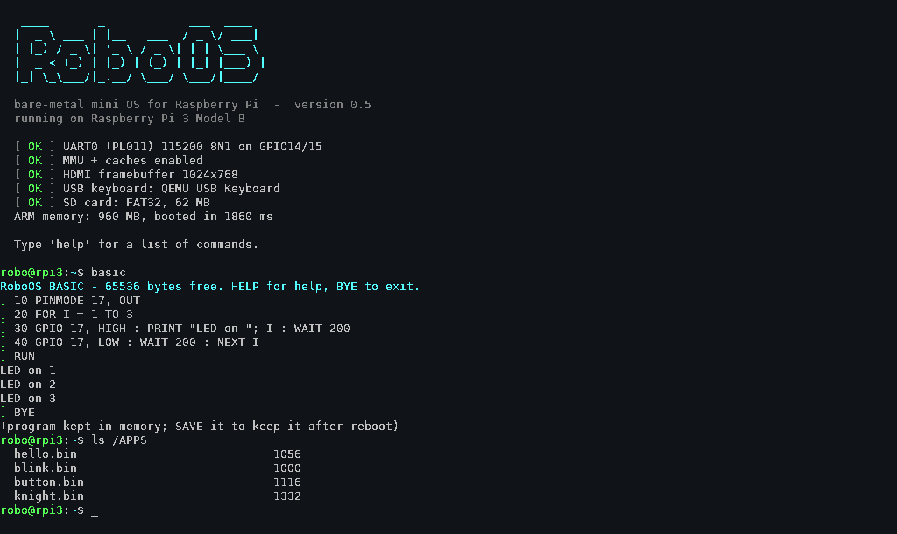
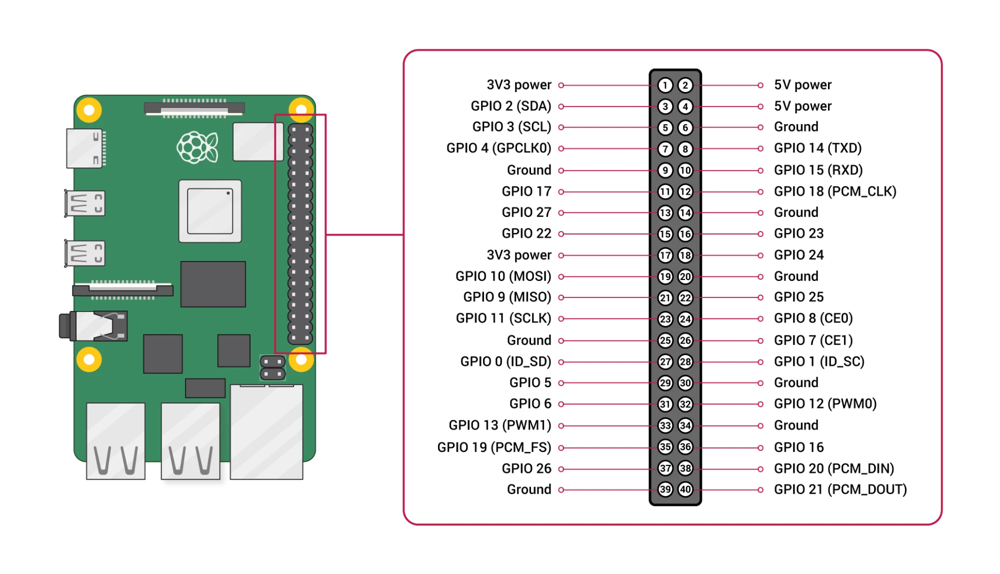

# RoboOS

[English](README.md) | **Slovensky**



Mini operačný systém pre Raspberry Pi, ktorý beží priamo na hardvéri, bez Linuxu.
Ovláda sa **USB klávesnicou** alebo cez sériovú linku (UART). Výstup ide naraz na
HDMI aj UART a oba vstupy fungujú súčasne.

Aktuálna verzia: **0.141**

## Podporované dosky

Jeden `kernel8.img` beží na všetkých doskách so 64-bitovým čipom BCM2837. Model sa
zistí pri štarte (vypíše sa pod logom a v prompte, napr. `robo@zero2`).

| Doska | Poznámky |
|-------|----------|
| Raspberry Pi 3 Model B / B+ / A+ | otestované na 3B |
| Raspberry Pi Zero 2 W | mini-HDMI; klávesnica cez **OTG redukciu** do portu `USB` (napájanie do `PWR IN`); hot-plug funguje aj na tomto porte, s USB hubom aj bez neho |
| Raspberry Pi 2 Model B **v1.2** | v1.2 má čip BCM2837 (na doske je vytlačené „Raspberry Pi 2 Model B V1.2“) |
| Compute Module 3 / 3+ | |

Nepodporované: Pi 1, Zero / Zero W, Pi 2 v1.1 (32-bitové čipy), Pi 4 a Pi 5 (iné
periférie, USB za PCIe).

ACT LED je na GPIO expanderi firmvéru (3B, CM3), na GPIO29 (3B+, 3A+, Zero 2 W – aktívna v nule)
alebo na GPIO47 (Pi 2 v1.2).

## Príprava SD karty

1. Naformátuj SD kartu na **FAT32** s tabuľkou oddielov **MBR** (veľkosť nerozhoduje).
   Pri kartách nad 32 GB to vo Windows ide cez Raspberry Pi Imager (*Erase*) alebo `diskpart`.
2. Skopíruj na ňu celý obsah priečinka `sd/`:
   `bootcode.bin`, `start.elf`, `fixup.dat`, `config.txt`, `kernel8.img`
   a priečinky `APPS` (ukážkové programy), `RUN` (autostart) a `FIRMWARE` (firmvér WiFi čipu).
3. Vlož kartu do Raspberry Pi a zapni ho.

## GPIO lišta (rozloženie pinov)



*Obrázok: [dokumentácia Raspberry Pi](https://www.raspberrypi.com/documentation/computers/raspberry-pi.html), © Raspberry Pi Ltd, [CC BY-SA 4.0](https://creativecommons.org/licenses/by-sa/4.0/).*
Nepárne piny (1, 3, ... 39) = vnútorný rad, párne (2, 4, ... 40) = rad pri okraji dosky. Čísla v príkazoch RoboOS
sú vždy **čísla GPIO**, nie čísla pinov lišty.

Čo RoboOS predvolene používa:

| GPIO (pin lišty) | na čo |
|---|---|
| 2, 3 (3, 5) | I2C: senzory, displeje, hodiny RTC, FM rádio, I2C klávesnica |
| 14, 15 (8, 10) | sériová konzola (USB-TTL prevodník) |
| 8-11 (24, 21, 19, 23) | SPI: čítačka kariet RC522, Waveshare OLED HAT |
| 4 (7) | 1-Wire na IoT shielde (ovládač zatiaľ nie je) |
| 17, 27, 22, 5 (11, 13, 15, 29) | vstupy IoT shieldu IN1-IN4 = zóny alarmu (`alarm shield`) |
| 24, 25, 12, 16 (18, 22, 32, 36) | výstupy / relé IoT shieldu (24 = siréna alarmu) |
| 23 (16) | LED IoT shieldu (LED alarmu) |
| 6 (31) | tlačidlo zvončeka (THT shield) |
| 11, GND, 0, 5, 6, 13, 19, 26 (23-37 vnútorný rad) | klávesnica 4x4 nasunutá priamo (`alarm keypad plug`) |
| 18, 19 (12, 35) | zvuk na Zero 2 W (Pi 3 má jack) |

## Programy a autostart

SD karta je zároveň disk RoboOS (FAT32 alebo FAT16, čítanie aj zápis).
RoboOS má vlastný ovládač SD (firmvér len načíta `kernel8.img` a potom ustúpi).
Ak sa karta nenájde, `sd init` ukáže, ktorý krok zlyhal, a registre radiča.
Od verzie 0.28 beží karta na radiči SDHOST (ako v Linuxe), aby druhý radič (Arasan) ostal
neskôr voľný pre WiFi; ak SDHOST nefunguje, RoboOS použije Arasan ako predtým a pri štarte
ukáže žltý riadok `SDHOST:` s dôvodom. `sd` ukáže, ktorý sa používa, `sd init sdhost` /
`sd init emmc` skúsi jeden z nich.

- Všetko v **`/RUN`** (`*.bin` a `*.bas`) sa po štarte spustí samo, v abecednom poradí.
  Stlačením ľubovoľnej klávesy do 2 s sa autostart preskočí.
- `run <meno>` spustí program z aktuálneho priečinka, z `/RUN` alebo `/APPS`; prípona je
  nepovinná.
- Pohyb po karte: `cd APPS`, `cd ..`, `cd /`, `pwd`; prompt ukazuje, kde si
  (`robo@rpi3:/APPS$`). Všetky príkazy aj BASIC (`LOAD`, `SAVE`, `DIR`) berú cesty relatívne
  k aktuálnemu priečinku. **Tab** dopĺňa mená súborov a priečinkov.
- `mkdir <priečinok>` vytvorí priečinok (meno 8.3), `rm <súbor>` zmaže súbor, `rm <priečinok>`
  prázdny priečinok. Súbory firmvéru a jadra v `/` sú chránené: zmazať sa dajú len cez `rm -f`.
- **Ctrl+C** zastaví bežiaci program a vráti sa do shellu.

### BASIC – programovanie priamo na RPi

```
robo@rpi3:~$ basic
] 10 PINMODE 17, OUT
] 20 GPIO 17, HIGH : WAIT 500
] 30 GPIO 17, LOW : WAIT 500
] 40 GOTO 20
] RUN                      (Ctrl+C ho zastaví)
] SAVE "/RUN/blink"        (uloží sa ako /RUN/blink.bas -> spustí sa po každom štarte)
] BYE
```

- Príkazy: `RUN`, `LIST [a-b]`, `NEW`, `SAVE "meno"`, `LOAD "meno"`, `DIR [cesta]`, `HELP`, `BYE`;
  `MKDIR "priečinok"`, `RMDIR "priečinok"`, `KILL "súbor"` fungujú aj v programoch.
  Samotné číslo riadku riadok zmaže.
- Príkazy v programe: `PRINT`/`?`, `INPUT`, `LET`, `IF..THEN..ELSE`, `GOTO`, `GOSUB`/`RETURN`,
  `FOR..TO..STEP`/`NEXT`, `DIM`, `END`, `REM`/`'`, `CLS`, `RANDOMIZE`; viac príkazov oddeľ `:`.
- GPIO: `PINMODE pin, OUT|IN|PULLUP|PULLDOWN`, `GPIO pin, HIGH|LOW`, `GPIO(pin)`, `LED ON|OFF`, `WAIT ms`.
- Obrázky: `IMAGE "súbor", x, y [, w, h]` (pozri časť o obrázkoch).
- Video: `VIDEO "súbor.mpg"` (pozri časť o videu).
- Zvuk: `SOUND Hz, ms`, `PLAY "noty"`, `VOLUME 0-100`, `PLAYWAV "subor.wav"` (pozri časť o zvuku).
- Sieť: `NETSEND`, `NETOK`, `NETAVAIL`, `NETRECV`; TCP/UDP: `TCPCONNECT`, `TCPLISTEN`,
  `TCPACCEPT`, `UDPOPEN`, `SOCKPRINT`, `UDPSEND`, `SOCKAVAIL`, `SOCKGET`, `SOCKNUM`, `SOCKCLOSE`
  (pozri časti o sieti).
- Funkcie: `ABS()`, `RND(n)`, `MIN(a,b)`, `MAX(a,b)`, `MILLIS`, `MICROS`, `INKEY`, `TEMP`, `CHR$()` (v PRINT).
- Iba celé čísla (64-bit). Kľúčové slová musia byť oddelené medzerami. Súbory `.bas` sú
  obyčajný text, dajú sa písať aj na PC.
- Mená súborov pri ukladaní: 8.3 (max. 8 znakov + prípona).

Ukážky na karte: `APPS/blink.bas`, `APPS/button.bas`, `APPS/knight.bas`,
`APPS/ledsrv.bas` (LED ovládaná cez TCP), `APPS/udptemp.bas` (teplota cez UDP),
`APPS/sound.bas` (tóny a pesnička).

### Textový editor

`edit <súbor>` otvorí celoobrazovkový editor, takže `.bas` a textové súbory sa dajú písať
a meniť priamo na RPi (`edit /RUN/blink.bas`, potom `run blink`).

| Klávesa | Akcia |
|---------|-------|
| šípky, Home, End, Page Up, Page Down | pohyb kurzora |
| Backspace, Delete, Enter, Tab | úpravy (Tab vkladá medzery) |
| Ctrl+S | uložiť |
| Ctrl+Q | koniec (pri neuložených zmenách sa opýta) |
| Ctrl+K / Ctrl+U | vystrihnúť aktuálny riadok / vložiť ho nad riadok s kurzorom |
| Ctrl+L | prekresliť obrazovku |

- Súbory do 1 MB. Nové súbory sa ukladajú s menom 8.3 (max 8 znakov + prípona);
  súbor s dlhým menom sa dá prezerať, ale nie uložiť.
- Konce riadkov ostávajú, aké boli (CR LF alebo LF); nové súbory majú CR LF.
- Na UART termináli používa editor rozmer HDMI textu (128x48), takže okno terminálu
  musí byť aspoň také veľké; bez HDMI používa 80x24.

### Programy v C (SDK)

Priečinok `sdk/` kompiluje programy v C s API v štýle Arduina:

```c
#include "robos.h"

void setup(void) { pinMode(17, OUTPUT); }

void loop(void)
{
    digitalWrite(17, HIGH); delay(500);
    digitalWrite(17, LOW);  delay(500);
}
```

`cd sdk && make` preloží každý `examples/*.c` na `bin/*.bin`; tie skopíruj na kartu
(do `/RUN` pre autostart). API: `pinMode`, `digitalWrite`, `digitalRead`, `delay`,
`delayMicroseconds`, `millis`, `micros`, `print`, `println`, `printf`, `getKey`,
`clearScreen`, `textColor`, `actLed`, `cpuTemperature`, `stopRequested`, `exit`,
`netSend`, `netReceive`, `netName` a TCP/UDP: `tcpConnect`, `tcpListen`, `tcpAccept`,
`udpOpen`, `sockWrite`, `sockPrint`, `sockRead`, `sockAvailable`, `udpSendTo`,
`udpReceiveFrom`, `sockClose`, `sockError`, `ipAddress` a zvuk: `tone(hz, ms)`, `noTone`,
`playNotes`, `soundVolume`, `playWav`, obrázky: `drawImage(path, x, y, w, h)`, `imageError` a
video: `playVideo(path)`, `videoError`, súbory: `readFile`, `writeFile`
(viď `sdk/robos.h`). Program môže mať `setup()` + `loop()` alebo `main()`.
Ukážky: `hello`, `blink`, `button`, `knight`, `chat`, `tcpserv` (TCP server), `udpecho` (UDP),
`music` (pesnička a siréna), `alarm` (pozri nižšie).

### Ukážka: alarm (`alarm`)

Od 0.120 je alarm aj v jadre (príkaz `alarm`, webová stránka, Home Assistant - pozri
„Zabezpečovací systém v jadre“); tento program ostáva ako príklad programovania.
`run alarm` spustí malý zabezpečovací systém (`sdk/examples/alarm.c`); skopíruj ho do `/RUN`, aby
štartoval sám. Nastavenia sú v `/ALARM.TXT` (pri prvom štarte sa vytvorí s predvolenými):

```
code 1234                    # PIN na zapnutie a vypnutie
exit 20                      # sekundy na odchod po zapnutí
entry 15                     # sekundy na vypnutie po otvorení zóny "delay"
siren 180                    # sekundy sirény (0 = kým sa nevypne)
siren_pin 24                 # výstup: siréna / relé (HIGH = zapnutá)
armed_pin 23                 # výstup: LED - svieti = zapnutý, bliká = odchod / príchod, rýchlo = poplach
sound on                     # pípanie, tón sirény a hlas na audio jacku
volume 80
voice /ALARM                 # priečinok s hlasovými WAV ("none" = len tóny)
port 8080                    # TCP port pre JSON (0 = vypnuté)
zone 17 delay nc Front door  # zone <gpio> <instant|delay|24h> <nc|no> <meno>
zone 27 instant nc Window
zone 22 instant no PIR hall
zone 5 24h nc Tamper
```

- **Vstupy** majú zapnutý vnútorný pull-up: kontakt zapoj medzi GPIO a GND. `nc` = rozpínací
  (dverový kontakt: otvorené = poplach), `no` = spínací (relé PIR, panické tlačidlo: zopnuté =
  poplach). `instant` = poplach hneď, keď je zapnutý, `delay` = spustí príchodový čas (cesta dnu,
  počas odchodového času sa nevšíma), `24h` = poplach vždy, aj vypnutý (sabotáž, panika).
  Kým je otvorená zóna instant / 24h, zapnúť sa nedá.
- **Sériový port / klávesnica**: `arm 1234`, `disarm 1234`, `status` (kód sa ukazuje ako `*`).
  Každá udalosť sa vypíše ako `[ALARM hh:mm:ss] ...` na sériový port aj na obrazovku.
- **JSON** na TCP porte: jeden riadok cez `nc <doska> 8080`, alebo HTTP
  (`curl -d "{\"cmd\":\"disarm\",\"code\":\"1234\"}" http://<doska>:8080/`; GET = stav):
  `{"cmd":"arm","code":"1234"}`, `{"cmd":"disarm","code":"1234"}`, `{"cmd":"status"}`.
  Odpoveď obsahuje stav, sirénu, zostávajúce sekundy, príčinu a všetky zóny.
- **Zvuk**: pípnutie každú sekundu odchodového / príchodového času, posledných 10 sekúnd
  hlasom, siréna ako stúpajúci a klesajúci tón a hlásenia udalostí. Na karte sú slovenské
  hlasové súbory v `/ALARM` (`ARMING`, `ARMED`, `ENTRY`, `ALARM`, `DISARMED`, `WRONG`, `NOARM`,
  `1`-`10` `.WAV`) vyrobené cez `tools/mkvoice.sh sk` s espeak-ng (`tools/mkvoice.sh en` po
  anglicky) - nahraď ich vlastnými nahrávkami. Hlasový súbor sa dohrá, až potom alarm pokračuje.
- Päť zlých kódov zablokuje kód na 60 s. Je to ukážka: Ctrl+C na doske ju ukončí.

Programy vedia od API verzie 8 čítať a zapisovať súbory: `readFile(path, buf, max)`,
`writeFile(path, data, len)`.

Programy sa nahrávajú na adresu 0x01000000 (max. 16 MB). Ak program spadne, vypíše sa
výnimka a systém sa vráti do shellu.

**GPIO má 3,3 V** (nie 5 V ako Arduino Uno), max. asi 16 mA na pin.
LED zapájaj cez odpor 220–330 Ω, relé a motory cez tranzistor alebo modul.

## Obrázky

RoboOS zobrazí na HDMI obrazovke JPEG (aj progresívny), PNG (s priehľadnosťou), BMP a GIF
(prvý snímok); veľký obrázok zmenší, aby sa zmestil, a zachová jeho tvar.

- `view <obrázok>` ho ukáže na celú obrazovku; **šípky vľavo/vpravo** (alebo medzera)
  prejdú na predchádzajúci / ďalší obrázok v tom istom priečinku, **Q** alebo Enter vráti
  textovú obrazovku tak, ako bola. `view <priečinok>` začne prvým obrázkom v ňom.
- **Obrázok pri štarte**: súbor `/SPLASH.PNG` (alebo `/SPLASH.JPG`, `/SPLASH.BMP`) sa ukáže,
  kým RoboOS štartuje; hlásenia sa píšu za ním a objavia sa najskôr po 2,5 s (klávesa to
  skráti). Na karte je obrázok s logom RoboOS - nahraď ho vlastným (najlepšie 1024x768),
  alebo ho zmaž a doska naštartuje rovno do textu.
- BASIC: `IMAGE "foto.jpg", x, y` nakreslí obrázok na x, y (pixely; 1024x768, ak ho `screen` nezmenil);
  `IMAGE "foto.jpg", x, y, w, h` ho vtesná do rámčeka w x h. C: `drawImage(path, x, y, w, h)`.
- Obrázky sa dekódujú v pamäti: 12-megapixelová fotka z mobilu trvá pár sekúnd.

## Rozlíšenie obrazovky

Textová obrazovka štartuje v 1024x768. `screen 1280x720` (hocijaká veľkosť od 320x200 po
2048x1280) prepne hneď a uloží sa do `/SCREEN.TXT`, takže ju použije aj ďalší štart;
`screen auto` použije vlastné rozlíšenie monitora (to, ktoré firmvér našiel na HDMI),
samotné `screen` ukáže aktuálnu veľkosť a veľkosť monitora. Ak ostane obraz čierny,
zmaž `/SCREEN.TXT` na PC (alebo doň napíš `1024x768`).

RoboOS si od grafického čipu pýta **dve stránky obrazovky**: text je na prvej, video sa
kreslí do skrytej a potom sa ukáže naraz (page flip), takže sa obraz netrhá.

## Video

`video <súbor.mpg>` prehrá video na celú obrazovku so zvukom (jack, GPIO18/19 alebo I2S DAC -
vyberá `sound out`). **Q** alebo Enter ho zastaví, **medzera** pozastaví, **šípky
vľavo/vpravo** skočia o 10 s späť / dopredu; shell potom vypíše, koľko snímok sa ukázalo
a koľko snímok za sekundu.

Formát je **MPEG-1 video so zvukom MP2** (`.mpg`, ako na Video CD): voľný, patenty dávno
vypršali a dekodér (pl_mpeg) je dosť malý, aby bežal priamo na doske. MP4 (H.264 / AAC) je
licencovaný a potrebuje hardvérový dekodér v GPU, ktorého rozhranie je uzavreté, preto ho
RoboOS neprehrá. Hocijaké video prekonvertuješ na PC cez ffmpeg:

```
ffmpeg -i film.mp4 -vf scale=640:-2 -c:v mpeg1video -q:v 4 -c:a mp2 -b:a 192k -f mpeg FILM.MPG
```

- Pre Pi 3 je dobrá veľkosť 640x360 alebo 640x480 pri 25/30 snímkach za sekundu; obraz sa
  zväčší na obrazovku (najviac 2x) a zachová tvar. `-q:v` 2 (najlepšie) .. 10 (najmenšie).
- Práca je rozdelená medzi jadrá: jadro 0 číta kartu a dekóduje, **jadrá 2 a 3** zároveň
  prepočítavajú farby (YCbCr na RGB) a zväčšujú predchádzajúcu snímku, jadro 1 drží USB
  a sieť. Ak to doska nestíha, snímky sa vynechajú (zvuk nikdy).
- BASIC: `VIDEO "film.mpg"`; C: `playVideo(path)` (API verzia 7, `videoError()`).

## Sieť: správy medzi RoboOS doskami

Pi 3B (LAN9514) a Pi 3B+ (LAN7515) majú ethernetový čip, ktorý je USB zariadenie za hubom
na doske; RoboOS má ovládač pre oba (oba fungujú: DHCP, NTP). 3B sa pripojí rýchlosťou 100 Mbit, 3B+ 1000 Mbit
(`net speed 100` ju obmedzí; cez USB 2.0 čip prenesie najviac asi 300 Mbit). Zapoj dosky do
toho istého switchu alebo routera a môžu si posielať krátke textové správy.
Protokol je vlastný, na surových ethernetových rámcoch (EtherType `88b5`), takže PC mu
nerozumie. Na komunikáciu s PC a internetom je TCP/IP (ďalšia časť).

```
robo@rpi3:~$ net who
  rpi3-1c2d        b8:27:eb:11:1c:2d  seen 0 s ago
robo@rpi3:~$ net send rpi3-1c2d hello
delivered
```

- Každá doska má meno: predvolene `rpi3-` + koniec jej MAC adresy.
  `net name <nové>` ho zmení a uloží do `/NAME.TXT` na SD karte.
- `net who` sa opýta, kto je v sieti. `net send <meno> <text>` pošle správu a čaká na
  potvrdenie (3 pokusy); `net send all <text>` ide všetkým, bez potvrdenia.
- Správa, ktorá príde, keď si v shelli na prompte, sa vypíše ako `[NET] meno: text`.
  Kým beží program, správy čakajú v schránke (posledných 8) na program.
- `net` ukáže meno, čip, MAC adresu, stav linky a počítadlá. `net test [sekundy]`
  vypisuje všetky rámce na linke, `net loop on` vracia odoslané správy späť na tú istú
  dosku (skúšanie s jednou doskou alebo v QEMU).
- BASIC: `NETSEND "meno", 42` alebo `NETSEND "ALL", "text"`; `NETOK` povie, či posledné
  odoslanie prešlo; `NETAVAIL` je počet čakajúcich správ a `NETRECV` vráti najstaršiu
  ako číslo. Príklad: jedna doska posiela tlačidlo, druhá rozsvieti LED:

  ```
  10 PINMODE 27, PULLUP : REM doska A        10 PINMODE 17, OUT : REM doska B
  20 NETSEND "ALL", GPIO(27) : WAIT 100      20 IF NETAVAIL THEN GPIO 17, NETRECV = 0
  30 GOTO 20                                 30 GOTO 20
  ```
- Programy v C: `netSend(to, text)`, `netReceive(from, text, max)`, `netName()`;
  pozri `sdk/examples/chat.c` (`run chat` = chat medzi doskami).

Nie je na Zero 2 W a 3A+ (nemajú Ethernet). 3B a 3B+ sa medzi sebou dohovoria.

## Sieť: TCP/IP

RoboOS používa [lwIP](https://savannah.nongnu.org/projects/lwip/) 2.2.1 (v `lwip/`,
licencia BSD), malý TCP/IP stack napísaný pre systémy bez operačného systému.
Po štarte si doska vypýta od routera adresu (DHCP) a pošle mu pritom svoje meno, takže
router ju v zozname zariadení ukáže pod jej RoboOS menom. Keď adresa príde, na prompte
sa objaví `[NET] IP address ...`.

```
robo@rpi3:~$ ip
host:    rpi3-9a4f
link:    up
address: 192.168.1.37 / 255.255.255.0  (DHCP)
gateway: 192.168.1.1
dns:     192.168.1.1
robo@rpi3:~$ ping 192.168.1.1
reply from 192.168.1.1: seq=1 ttl=64 time=0.9 ms
```

- `ip` ukáže adresu; `ip set <adresa> [maska] [brána]` nastaví pevnú adresu,
  `ip dhcp` vráti DHCP. Voľba sa uloží do `/IP.TXT` na SD karte.
- `ping <adresa alebo meno> [počet]` - mená sa prekladajú cez DNS.
- `ip` počíta aj rámce: `in` (ARP, IPv4, iné, s VLAN značkou) a `out` (chyby) - ak
  `in` ostáva blízko 0, k doske nič nechodí (kábel, switch, router). Rámcom s VLAN značkou
  (802.1Q, aj „len priorita“, ktorú pridávajú niektoré routery) sa značka odstráni.
- `http on` spustí malú webovú stránku s menom dosky, verziou, dobou behu a teplotou
  CPU: otvor `http://<adresa>/` v prehliadači. `http off` ju vypne. Voľba sa uloží do
  `/HTTP.TXT`, takže stránka (aj API nižšie) sa po reštarte spustí sama.
- Len IPv4.

### WiFi (vo výstavbe)

WiFi čip (CYW43438 na Pi 3B, CYW43436 na Zero 2 W, CYW43455 na Pi 3B+) visí na SDIO. Zatiaľ ho
RoboOS spustí, hľadá siete a pripojí sa (WPA2-PSK alebo otvorená sieť):

```
wifi scan                     nahrá firmvér do čipu a vypíše siete okolo
wifi join MojaSiet heslo      pripojí sa (uloží sa do /WIFI.TXT: po reštarte sa pripojí sama)
wifi join "Moja Siet" heslo   meno s medzerami
wifi                          čip, firmvér, MAC adresa, sieť, signál
wifi band 2|5|auto            len 2,4 GHz / len 5 GHz / obe (len Pi 3B+ - 3B a Zero 2 W majú len 2,4 GHz; uloží sa; pri sieti na oboch pásmach
                              vyberá firmvér, 'wifi' ukáže kanál, na ktorý sa pripojil)
wifi leave                    odpojí sa (a prestane sa pripájať znova);  wifi forget  zmaže aj /WIFI.TXT
```

WPA2 handshake robí firmvér čipu sám. Jedno IP rozhranie nesie všetko (DHCP, web, API, HTTPS,
NTP, programy): **Ethernet, keď je zapojený kábel, inak WiFi** - vytiahnutie kábla prepne na
WiFi (`[NET] now on WiFi`, nová adresa cez DHCP). `ip` ukáže, ktoré sa používa. Zero 2 W
Ethernet nemá, takže WiFi je jej sieť.

Čip potrebuje svoj firmvér na karte v `/FIRMWARE` - je v `sd/FIRMWARE`, takže stačí skopírovať
`sd/` (`tools/getwifi.sh` stiahne čerstvú kópiu): `brcmfmac43430-sdio.bin` + `.txt` + `.clm_blob` (Pi 3B; novší
firmvér bez `.clm_blob` nezapne rádio),
`brcmfmac43436-sdio.bin` + `.txt` + `.clm_blob` (Zero 2 W), `brcmfmac43455-sdio.bin` + `.txt` +
`.clm_blob` (Pi 3B+). Tieto súbory nie sú súčasťou RoboOS: sú to nezmenené kópie z balíka
firmware-nonfree od Raspberry Pi pod licenciami Cypress / Synaptics, ktoré ich dovoľujú šíriť na
použitie s ich čipmi - pozri `sd/FIRMWARE/README.txt` a súbory `LICENCE.*` vedľa nich. WiFi potrebuje
SD kartu na SDHOST (pozri časť o SD karte). Na Pi 3B funguje scan aj pripojenie; na Pi 3B+ funguje scan
(2,4 aj 5 GHz). Firmvér Pi 3B+ nemá zabudovaný WPA supplicant, preto od 0.36 robí WPA2-PSK handshake
sám RoboOS (`src/wpa.c`: PBKDF2, 4-way a skupinový handshake, AES key unwrap; overené na PC proti
testovacím vektorom IEEE 802.11 a prístupovému bodu v Pythone, `tools/test_wpa.py`) - `wifi join` potom
napíše "RoboOS does the WPA2 handshake" (len informácia). Ak sa pripojenie nepodarí (pri štarte, po strate signálu, po reštarte routera), doska to skúša znova sama:
po 20 s, potom raz za minútu (`[NET] WiFi: joining <sieť> again`), kým nedáš `wifi leave`. Na Pi 3B+ to **funguje** (pripojenie, DHCP aj ping cez
WiFi s vytiahnutým káblom). Siete len s WPA3 (SAE) nie sú podporované (zmiešané WPA2/WPA3 áno). **Funguje aj Zero 2 W** (štart, USB klávesnica cez OTG, WiFi).

### Bluetooth (BLE: senzory, mobil)

WiFi čip je zároveň Bluetooth čip. Zapne sa, až keď ho zavoláš:

```
bt on            zapnúť: počúva zariadenia okolo a mobil ho nájde
bt scan          čo je okolo (bt scan 20 = počúvať 20 s)
bt sensors       Bluetooth teplomery ako JSON
bt pair          spárovať Bluetooth klávesnicu (klasický BT; bt pair aa:bb:cc:dd:ee:ff = konkrétnu)
bt forget        zabudnúť spárovanú klávesnicu
bt               stav (pripojený mobil, zariadenia, teplomery)
bt off           vypnúť
bt auto on|off   zapnúť pri štarte (/BT.TXT)
```

**Senzory.** Teplomery Xiaomi LYWSD03MMC s voľným firmvérom ATC / pvvx (service data 0x181A) sa
čítajú stále, kým je Bluetooth zapnutý: `bt sensors`, `GET /api/ble` a MQTT `roboos/<meno>/ble/<mac>` =
`{"temp":21.53,"hum":45.12,"batt":87,"rssi":-63,"name":"ATC_112233"}` (najviac raz za 30 s), Home
Assistant ich nájde sám (teplota, vlhkosť, batéria). `bt scan` ukáže aj mená a výrobcov všetkého
ostatného (mobily, TV, slúchadlá). Od 0.43 hľadá aj klasické Bluetooth zariadenia (označené `BR`)
a označí klávesnice a myši: `[keyboard, BLE]` alebo `[keyboard, classic BT]` - tak zistíš, akú máš
klávesnicu (lacné bývajú klasický Bluetooth 3.0, ten potrebuje iný ovládač ako BLE).

**Mobil.** Doska sa ukáže pod svojím menom (`rpi3-...`) so službou Nordic UART. Pripoj sa terminálovou
aplikáciou - Android: *Serial Bluetooth Terminal* (Devices -> Bluetooth LE), iPhone / Android:
*nRF Toolbox* (UART) alebo *Bluefruit Connect* (UART) - a píš:

```
help                          príkazy
status                        meno, verzia, čas behu, adresa, čas
sensors                       CPU, BME280, ADS1115 a Bluetooth teplomery
gpio 17                       prečíta pin;  gpio 17 1 / gpio 17 0 / gpio 17 toggle = nastaví
login robo MojeHeslo1         treba, keď sú používatelia ('users add'); "view" len číta
```

Párovanie zatiaľ nie je: spojenie nie je šifrované, používaj ho nablízku (heslo napísané tam ide
vzduchom čitateľne). Kým je Bluetooth zapnutý, UART konzola beží na mini UARTe - rovnaké piny 8/10,
rovnakých 115200; `bt off` ju vráti. Scan funguje na Pi 3B (19 zariadení na prvý pokus) aj na Zero 2 W (12 zariadení); časť s mobilom
je vyskúšaná v QEMU (`tools/qemu_bt_test.py` hrá radič aj mobil). 
**Klávesnica (0.44, klasický Bluetooth).** Prepni klávesnicu do režimu párovania (zvyčajne podržať Connect
alebo Fn+C, kým nebliká LED) a napíš `bt pair`. RoboOS ju nájde, pripojí sa a ukáže číslo:
`on the keyboard type 123456 and press Enter` - napíš ho **na Bluetooth klávesnici**. Potom píše do shellu
ako USB klávesnica (US rozloženie, autorepeat). Kľúč sa uloží do `/BTKEYS.TXT`: po reštarte (s `bt auto on`)
alebo keď klávesnica zaspala, stlač kláves a pripojí sa sama. `bt` ukáže stav, `bt forget` kľúč zmaže.
BLE klávesnice zatiaľ nie. Čip na 3B+ má zástupnú Bluetooth adresu (43:45:c0:00:1f:ac, rovnakú na každej
doske); od 0.44 mu RoboOS dá vlastnú (b8:27:eb + sériové číslo, ako Raspberry Pi OS). **Funguje na Pi 3B+** s lacnou
klasickou BT klávesnicou (párovanie, písanie, pripojenie po reštarte); 0.45 nechá klávesnicu, nech sa pri
pripájaní overí sama (0.44 to krížila: chyba 0x05, jeden pokus navyše). 0.45 tiež nahráva firmvér Bluetoothu rýchlosťou
921600 baudov (8x rýchlejšie: `bt auto on` už nepredĺži boot o ~6 s) a pripojenie WiFi pri štarte robí I/O jadro,
takže WPA handshake routera dostane odpoveď hneď (predtým sa 3B+ často pripojila až na pokus o 20 s neskôr).
0.46: Bluetooth na pozadí počúva len 10 % času (30 ms z 300 ms, `bt scan` 50 %) - WiFi a Bluetooth zdieľajú
jedno rádio a 50 % hľadanie na 3B+ kazilo WPA handshake až do 3. pokusu; WiFi pri ďalšom pokuse vypíše, prečo
predošlý zlyhal. 0.49: ďalší pokus nikdy nepreruší ten, ktorý sa ešte pripája alebo robí WPA handshake (0.46 skúšala
znova po 10 s, a preto sa pripojila až na 4. pokus): po chybe o 2 s, inak o 20 s; vypíše aj, ako dlho pokus trval
(`connected to ... (N s)`). 0.50: na 3B+ (WPA handshake robí RoboOS) sa ignoruje WPA hlásenie
firmvéru - 0.49 ho brala ako chybu a reštartovala pripájanie uprostred handshake (10 pokusov). 0.51: `wifi` vypíše posledných 10 pokusov s časom
každého kroku (sieť nájdená, spojenie, WPA msg1/msg3, kľúče, strata + dôvod) - jedna fotka ukáže, kde sa pripájanie zastaví. 0.52: router
odpovedal na rýchle pokusy odpojením s dôvodom 2 („predošlé prihlásenie už neplatí“) 20-krát: teraz sa pred každým
ďalším pokusom Pi najprv korektne odpojí (disassociate, 0,3 s) a po odmietnutí skúša znova o 15 s, nie o 2 s. Na Pi 3B+ sa WiFi teraz pripojí na prvý pokus do sekundy.
0.53: s `bt auto on` a nastavenou WiFi sa Bluetooth zapne až po pripojení WiFi (najneskôr o 15 s) - zdieľajú
jedno rádio a štart Bluetoothu predĺžil pripojenie WiFi pri štarte na 20 s. QEMU test: `tools/qemu_btkbd_test.py`.
0.54: `history` vypíše posledných 30 príkazov (predtým 10), `!N` / `!!` spustí príkaz znova, `history clear` ju zmaže; história
sa ukladá do `/HISTORY.TXT` na karte, takže prežije reštart. WiFi: odmietnutý PRVÝ pokus po štarte sa opakuje o 3 s (nie o 20 s), rovnako prvý pokus,
kde WPA handshake zastal (msg2 odoslaná, msg3 do 5 s neprišla) - na fotke vlastníka router pri štarte na našu msg2 neodpovedal
a po 18 s Pi odpojil, druhý pokus sa potom pripojil za 3 s.
0.55: I2C displeje - OLED SSD1306 / SH1106 a LCD 16x2 / 20x4 s modulom PCF8574, nájdu sa pri štarte, stavová obrazovka
(meno, IP, čas), `display`, BASIC `DISPLAY`, C API 11 (pozri „I2C displej“).
0.56: `ai` - otázky pre Claude s vlastným API kľúčom (pozri „AI“); riadok shellu až 255 znakov; viac koreňových
certifikátov pre HTTPS (DigiCert G5, SSL.com, Certainly, Microsoft, IdenTrust).
0.57: OLED displeje, ktoré na I2C nepotvrdzujú (ACK) - 2,42" dosky SSD1309 s otvoreným D2 (na ESP išli, jeho softvérové I2C
ACK ignoruje): `display type ssd1306` ich použije aj tak, zápis softvérovým I2C na GPIO2/3.
Nájdu sa aj OLED radiče, ktoré odpovedajú na zápis, ale nie na čítanie (SSD1309): `i2c scan` a hľadanie displeja
skúšajú 0x3C/0x3D aj zápisom.
0.58: písma displeja (small 21 x 8 / normal / big), `display console on` (kópia terminálu), text cez sieť
(`/api/display`, MQTT `set/display`). 2,42" OLED na 3B+ funguje (vlastník: ukazuje IP aj čas).
0.59: `display font tiny` = 32 x 10 znakov (X11 4x6, voľné použitie); OLED sa kreslí do obrázka v pamäti a posielajú
sa len zmenené 8-bodové pásy. Riadky 1-10 v BASICu, API aj MQTT.
0.60: `display time` = veľké digitálne hodiny (na 128x64 aj s dátumom), `display info` = stavová obrazovka;
`display console off` sa vráti na stavovú obrazovku (v 0.59 nechal displej prázdny). Režim sa uloží.
0.61: hodiny tenkými číslicami (DejaVu Sans, `tools/mkclock.py`) namiesto hrubých 3x zväčšených, sekundy menšie
hneď vedľa HH:MM, dátum písmom 8x16 pod nimi.
0.62: `font tiny` je teraz čitateľnejšie X11 5x8 (25 x 8); stiesnené 4x6 (32 x 10) je `font micro`.
0.63: nezašifrovaný API kľúč zapísaný do `/AI.TXT` na PC (`key sk-ant-...`) sa prijme a pri prvom `ai` zašifruje.
0.64: aj samotný kľúč v `/AI.TXT`, alebo `API_KEY="sk-ant-..."` - hocijaký riadok s `sk-ant-`.
0.65: `ai` vypisuje každý krok (pripájanie, TLS, odosielanie, čakanie, čítanie, s ms) - vlastníkovi to zastalo
po "asking ..." a nebolo vidno kde.
0.66: viac na hľadanie zamrznutia: riadok odpovede ukáže HTTP stav, dĺžku a chunked; počas čakania každých 5 s
"still waiting: N bytes in so far, core 1: <čo robí> (loops)".
0.67: OPRAVA zamrznutia `ai`: po odpovedi po kúskoch (chunked; API vrátilo HTTP 429) sa BearSSL pri slušnom
ukončení TLS (`br_sslio_close`) zacyklil navždy - zopakované v QEMU; HTTPS klient teraz len zatvorí TCP spojenie.
Pri 429 napíše, že ide o limit volaní / výdavkov alebo kredit.
0.68: OPRAVA: `i2c scan` „našiel“ 0x3c / 0x3d aj bez ničoho pripojeného (skúška zápisom pre OLED): neskoré
chýbajúce ACK sa zachytí a zápisu sa verí, len ak rezervovaná adresa 0x7c NEodpovie. `i2c scan` aj upozorní,
ak sú SDA / SCL v pokoji nízko (skrat, prehodené vodiče, nenapájaný modul).
0.69: na prázdnej zbernici vlastníka stále fantóm 0x3c -> skúška zápisom musí odpovedať 3-krát po sebe, `i2c scan`
označí také nálezy "[answers writes only]"; `i2c probe <adresa>` ukáže surový stav radiča + čas čítania a zápisu;
`i2c speed <kHz>` (10-400, do reštartu) - LCD moduly (PCF8574) zvládajú najviac 100 kHz.
0.70: uvoľnenie zaseknutej I2C zbernice - LCD modul vlastníka držal SDA dole ("SDA LOW" v `i2c scan`, nič sa
nenašlo), kým ho neuvoľnil neúspešný prenos; teraz pri štarte, pred `i2c scan` a po vypršaní času RoboOS pošle až
9 hodinových impulzov + STOP, keď je SDA zaseknutá dole (`i2c scan` to napíše).
0.71: FM rádio - `radio` pre modul RDA5807M (ladenie, hľadanie, zoznam staníc, hlasitosť, RDS názov + text,
`display radio`, /api/radio, MQTT set/radio); MPU-6050 na 0x68 sa už nepovažuje za hodiny DS3231 (kontrola WHO_AM_I).
0.72: Waveshare 1,3" OLED HAT (SH1106 na SPI0 + 3 tlačidlá + joystick) ako panel rádia: `display hat`, `display keys`;
nový ovládač SPI0 `src/spi.c`.
0.73: senzor tlaku a teploty BMP180 (BMP085) na 0x77 v `sensors`, MQTT, API a BASIC `SENSOR()`.
0.74: prijímač rádiových hodín DCF77 na GPIO pine (`dcf`): čas bez siete.
0.75: `dcf on` / `dcf off` (pin ostane uložený; s `dcf pon` sa vypne aj prijímač).
0.76: `dcf` ukazuje, ako dlho trvala každá úroveň (tabuľka + posledných 12 úsekov) - rozlíši signál od šumu.
0.77: dekodér DCF77 odolný voči šumu: zachytí sekundový rytmus a posudzuje každú sekundu ako celok (špičky už
neroztrhajú impulzy); dve dobré minúty, ktoré k sebe sedia, nastavia hodiny aj so zlými minútami medzi nimi.
0.78: DCF77 so slabým / zarušeným signálom: začiatok minúty sa nájde sám a bity sa sčítavajú cez viac minút
(hodina a dátum ostávajú, minúta rastie o 1), takže čas príde, aj keď má každá minúta chyby.
0.79: senzor vlhkosti a teploty AHT20 / AHT10 na 0x38 (napr. doska AHT20 + BMP280) v `sensors`, MQTT, API, BASIC.
0.80: hlasové príkazy offline s modulom DFRobot DF2301Q (`voice`): počutá veta spustí príkaz shellu.
0.81: oprava I2C - po adrese, ktorá neodpovedala, zlyhal ďalší prenos (radič ešte posielal STOP);
`i2c scan` a hľadanie senzorov pri štarte nevideli zariadenia, ktoré `i2c probe` videl.
0.82: senzory na displeji (`display sensors`, aj pod KEY1 na HATe), záznam do CSV (`sensors log 5` ->
/LOG/YYYYMMDD.CSV) a `GET /api/sensors` (JSON).
0.83: MPU-6050 / GY-521 (`motion`): náklon (vodováha), zrýchlenie, otáčanie, otrasy; displej, MQTT, API, BASIC.
0.84: oprava zobudenia MPU-6050 (GY-521 ostal spať a dával samé 0, čo navyše počítalo falošné otrasy).
0.85: `motion` beží naživo na celej obrazovke do stlačenia klávesy (vodováha pre pitch / roll); `motion once` vypíše raz.
0.86: MPU-6050 na vnútornom oscilátore (GY-521 sa zobudil, ale s hodinami z gyroskopu nemeral nič).
0.87: termokamera AMG8833 Grid-EYE (`thermal`): tepelná mapa naživo na HDMI, detekcia človeka (MQTT), displej, API, BASIC.
0.88: kamera na plochom kábli, krok 1 (`cam`): zapne kameru a nájde senzor (OV5647 / IMX219).
0.89: kamera krok 2: `cam live` / `cam snap` / `cam bars` - prvý obraz z OV5647 na HDMI (640x480).
0.90: `cam live` / `bars` vypíšu každý krok štartu (`cam 1` ... `cam 9`) - na 0.89 doska zamrzla, posledný riadok ukáže kde (`cam trace off` ich skryje).
0.91: počas čakania na prvú snímku sa každých 0,5 s vypíšu linky kamery a expozícia senzora; `cam clock cont|ncont` skúsi druhý režim MIPI hodín.
0.92: `cam dump` vypíše všetky registre prijímača kamery počas vysielania; `tools/camdump.py` vypíše to isté na Linuxe, kde kamera funguje - na porovnanie.
0.93: kamera teraz beží ako vo firmvéri Pi: režim senzora 1296x972 (zlúčené 2x2) a hradlo hodín liniek 0x155; `cam mode 640` / `cam gate 0x15` prepnú späť na skúšku.
0.94: senzor dostane presne ten zoznam registrov, ktorý zapisuje firmvér Pi (1296x976, zachytený projektom raspiraw) - bez synchronizačných paketov riadkov; `cam mode fw|1296|640`.
0.95: senzor sa nastaví a spustí PRED prijímačom kamery (ako rsta2/libcamera); `cam order rx` = staré poradie.
0.96: oprava: v režime z firmvéru senzor ostal v stave "bez snímok" (0x4202) zo štartu a posielal len takt.
0.97: Bluetooth volá spárovanú klávesnicu znova, kým sa neozve (každých 8 s, potom 20 s, po ~3 minútach každých 60 s), aj keď sa odpojí.
0.98: `cam sregs` vypíše všetky registre senzora kamery, ktoré RoboOS nastavuje, počas vysielania; `tools/ov5647regs.sh` vypíše ten istý zoznam na Linuxe - na porovnanie.
0.99: oprava kamery: počas čakania na snímky RoboOS tisíckrát za sekundu zapisoval stav prijímača späť (aj bity "zosynchronizované"); teraz maže len chybové bity. Predvolené ako Linux na tej istej doske: režim 1296x972, hradlo 0x15, najprv prijímač.
0.100: v režime 1296 dostane senzor presne hodnoty, ktoré v ňom necháva Linux (ručná expozícia 0x57e, zosilnenie 0x40, dĺžka snímky 0x602, zrkadlenie 0x3821 = 3, bez AWB).
0.101: NÁJDENÁ CHYBA kamery: RoboOS zapínal napájanie nesprávneho prijímača (doména firmvéru 13 = UNICAM0; konektor kamery používa UNICAM1 = 14), takže prijímač nikdy nevidel dáta. Opravené - **kamera na Pi 3B+ funguje** (majiteľ).
0.102: farby kamery: poradie farebných bodov podľa zrkadlenia senzora (GBRG v predvolenom režime 1296, ako Linux); `cam bayer bggr|gbrg|grbg|rggb`, ak farby nesedia.
0.103: fotky z kamery ako JPEG (`cam snap [súbor]`, s / medzera v `cam live`; vlastný kodér `src/jpeg.c`) + nastavenia obrazu v /CAM.TXT: expozícia, zisk, ev, vyváženie bielej, jas, kontrast, sýtosť, odtieň, gama, zrkadlenie, kvalita JPEG (`cam set`).
0.104: webová stránka kamery `/camera`: živý náhľad + posuvníky pre každé nastavenie + uloženie fotky; API `GET|POST /api/camera`, `GET /api/camera.jpg`; `cam test on` = skúšobný obraz bez kamery.
0.105: videozvonček (`doorbell`: tlačidlo na GPIO -> fotka na kartu + do Home Assistanta cez MQTT, gong / WAV, udalosť zvonenia) a radar pri dverách (fotka, keď niekto príde); MQTT kamera, tlačidlo Take photo, udalosť zvončeka, senzor radaru cez discovery; `cam send`.
0.106: IR prisvietenie kamery na GPIO (`cam ir <pin>`, `cam ir_mode off|on|photo|auto`; auto = len v tme), aj na stránke /camera.
0.107: ultrazvukový senzor HC-SR04 pri dverách (`doorbell distance <trig> <echo> [cm]`): fotka len keď je niekto bližšie ako hranica (s radarom: oba).
0.108: `microscope` - kamera na celú obrazovku so zoomom 1-5x (body snímača), šípky, fotka (medzera) a video MJPEG AVI (v).
0.109: mikroskop v plnom rozlíšení na celú obrazovku: režim snímača 1920x1080 (aj `cam mode 1080`), každý bod obrazovky z bodov snímača na 3 jadrách, `f` = celá obrazovka / celý obraz, fotky do 1920x1080.
0.110: ostrosť kamery (posuvník + `cam sharpness`), menej kmitania: kreslená snímka sa už neprepisuje ďalšou, expozícia v celých periódach siete (`cam flicker 50|60|off`), pokojnejšia automatika expozície a vyváženia bielej.
0.111: mikroskop bez šmúh v pohybe: kreslí sa do skrytej stránky obrazovky a zobrazí sa celá naraz (dvojitý buffer); `k` / `cam cores 1-3` = počet jadier na kreslenie.
0.112: zoom mikroskopu v jemnejších krokoch do 2,5x: 1; 1,2; 1,5; 1,8; 2; 2,2; 2,5 (`+` / `-`, klávesy 1-7).
0.113: s `cam flicker 50|60` automatická expozícia nikdy nejde pod jednu periódu siete (10 / 8,3 ms) - pri veľkom svetle radšej zníži zisk (blikanie lampy zmizne).
0.114: mikroskop: Enter zastaví video namiesto ukončenia (koniec len `q`), ukladanie ukazuje priebeh (%, MB, zostávajúce sekundy).
0.115: odšumenie kamery (`cam denoise on|off`, políčko na stránke, `d` v mikroskope); v mikroskope klávesy `,` `.` = ostrosť.
0.116: každý posuvník stránky `/camera` sa prejaví na ďalšej snímke, aj počas mikroskopu / `cam live` (jas, kontrast, sýtosť, odtieň, gama a pevná expozícia / zisk predtým nie).
0.119: časová značka (dátum + čas) vo fotkách, videách a fotkách pre Home Assistant (`cam stamp on|off`, políčko na stránke `/camera`).
0.120: zabezpečovací systém v jadre (`alarm`, webová stránka `/alarm`, v Home Assistant alarm panel + senzory zón + udalosti cez MQTT): zóny instant / delay / interior / 24h, away / home, relé sirény + tón + hlas, fotky + video pri poplachu, fotka pri príchode, záznam udalostí /ALARM.LOG, po výpadku prúdu znova zakódovaný; `alarm shield` pre piny IoT shieldu.
0.121: klávesnice a čítačky kariet pre alarm: klávesnica 4x3 / 4x4 na GPIO alebo na PCF8574 (I2C), RFID čítačka RC522 (SPI), Wiegand čítačky / klávesnice; `alarm card learn|add|del`, kód + # na klávesnici, režim displeja `alarm` (stav, hviezdičky, zostávajúce sekundy).
0.122: aktualizácia kernelu z webu: stránka `/update` s tlačidlami „Check“ a „Install“ (doska si sama stiahne z GitHubu, záloha KERNEL8.BAK, reštart, stránka na ňu počká), `GET|POST /api/kernel`.
0.123: SD karta sa pri štarte skúša až 4-krát (na 3B bolo po reštarte často treba `sd init`); keď bolo treba opakovať, riadok pri štarte povie, ako zlyhal prvý pokus.
0.124: inicializácia SD karty už nežiada od karty 1,8 V (S18R - Pi 3 to nevie; veľké SDXC karty sa potom môžu správať zle) a opakovaný pokus pri štarte kartu najprv vypne a zapne. Nastavenia ako webový token a `http on` sa čítajú z karty pri štarte - keď karta nebola pripojená, chýbali.
0.125: karta sa opraví sama: keď čítanie / zápis bloku zlyhá, karta sa raz znova inicializuje a skúsi to znova, a keď nebola pri štarte pripojená, každý prístup k súboru ju skúsi pripojiť (najviac raz za 2 s). `sd` ukáže, koľkokrát sa to stalo.
0.126: opätovná inicializácia karty už nikdy nesiahne na piny WiFi / radič Arasan (v 0.125 mohla automatická oprava karty odpojiť WiFi); pri štarte sa radič SDHOST skúša 3-krát, až potom náhradný Arasan.
0.127: firmvér WiFi sa prečíta z karty do pamäte ešte pred zapnutím WiFi čipu (na 3B so Samsung 64 GB kartou karta zlyhávala, keď sa jej čítanie striedalo s nahrávaním firmvéru).
0.128: nová úvodná stránka (`http://<doska>/`): dlaždice stavu (čas behu, čas, CPU, sieť, adresa, alarm, API, HTTPS), karty Alarm / Camera / Photos & videos / Files / Update / JSON API a tlačidlo Reboot (token alebo admin prihlásenie; stránka sa po reštarte sama načíta).
0.129: `alarm keypad gpio` bez čísel = fóliová klávesnica 4x4 priamo na lište (GPIO 5 6 13 19 / 12 16 20 21 = piny 29 31 33 35 / 32 36 38 40), tabuľka zapojenia v README.
0.130: `alarm keypad plug [reversed]` = 8-pinový konektor klávesnice nasunutý priamo na piny 23-37 (bez prepájania; vodič na GND pine sa číta naopak, fungujú všetky 16 klávesy); v `alarm keypad gpio` môže byť linka `gnd`.
0.131: `alarm keypad shield` (klávesnica so shieldom: GPIO 13 19 26 21 / 20 7 18 + GND); kolízie pinov klávesnice / čítačky so zónami alarmu alebo tlačidlom zvončeka sa ukážu (`!!`, `PIN TAKEN`) a taká zóna sa nesleduje.
0.132: `alarm keypad test` - naživo klávesa a úrovne liniek na kontrolu zapojenia klávesnice.
0.133: pri zapnutom alarme bežná stavová obrazovka displeja sama ukazuje alarm (stav, kód ako hviezdičky, zostávajúce sekundy); konzola ukazuje písaný kód ako hviezdičky (`[KEYPAD] code: ****`). Zóna bez pripojeného kontaktu sa javí ako otvorená (napr. okno z `alarm shield`) - nepoužité zóny zmaž (`alarm zone del 27`).
0.141: OPRAVA: kým išla prevádzka cez WiFi, zapojený kábel sa nikdy nezistil (linka sa kontrolovala len pri čítaní rámcov z kábla) - preto kábel + WiFi (0.140) kábel nepoužil.
0.140: OPRAVA terminálu klávesnice (0.139): každá číslica sa hneď zmazala a `#` hneď hlásil NO CONNECTION (časová značka neskoršia než čas slučky); `NO ANSWER`, keď kód prišiel, ale stav sa nevrátil. Správy medzi doskami idú teraz cez VŠETKY linky, ktoré sú hore - kábel AJ WiFi naraz, druhá kópia sa zahodí - takže jedna cesta môže vypadnúť; `net ip wifi` nechá TCP/IP (web, MQTT, čas) na WiFi aj so zapojeným káblom (/LINK.TXT), napr. ústredňa a klávesnica spojené káblom priamo doska-doska a obe aj na WiFi.
0.139: terminál klávesnice cez WiFi: kód sa drží na termináli a pošle sa CELÝ po # / A / B / D (jedna správa namiesto jednej za každú klávesu), displej ukazuje `Sending...`, kým ústredňa neodpovie, alebo `NO CONNECTION` + hlboké pípnutie; správy idú z frontu na pozadí (opakujú sa až do potvrdenia), takže klávesnica nikdy neprestane čítať klávesy; `alarm` ukazuje doručené / nedoručené správy a odoslania, ktoré WiFi čip odmietol.
0.138: webové stránky (/update, /alarm, Reboot na úvodnej stránke) ukážu, PREČO doska odmietla (zlý token, API vypnuté, zapnuté HTTPS, veľa pokusov), nielen znova pýtajú token.
0.137: terminál klávesnice reaguje po `#` hneď: ústredňa pošle nový stav ešte pred hlasovou hláškou (WAV blokuje sekundy) a posiela ho aj počas nej; neodpovedajúci terminál sa naozaj na 10 s nechá na pokoji.
0.136: pípak pre dosku s klávesnicou: `sound out gpio` + piezo / malý reproduktor na GPIO18 (pin 12) a GND; keď je GPIO19 linka klávesnice alebo Waveshare HATu, použije sa len GPIO18.
0.135: riadok `remote` sa dá nastaviť na webovej stránke /alarm (pri uložení tam sa strácal).
0.134: terminál klávesnice: `alarm remote <ústredňa>` urobí z inej dosky RoboOS klávesnicu + displej alarmu cez LAN (správy podpísané + šifrované rovnakým `http token`).
0.118: v mikroskope kláves `w` = režim kamery: 1920x1080 stred / 2592x1944 celý snímač (ostrý, ~15 snímok/s) / 1296x972 celý (rýchly); fotky až v plnom 2592x1944; `cam mode full`.
0.117: správca súborov na webe: `/files` a `/microscope` (zobraziť, stiahnuť, zmazať fotky a videá na karte).

### Dátum a čas (NTP)

Keď sieť beží, doska sa spýta NTP servera na čas (hneď a potom každú hodinu) a vypíše
`[NET] time 2026-11-18 21:05:07 (NTP pool.ntp.org)`. Nastavenia sú v `/TIME.TXT`:

```
time                     dátum, čas, pásmo a kedy sa synchronizoval
time zone +1 eu          posun od UTC (ide aj +5:30); eu = letný čas EÚ, bez neho žiadny
time server pool.ntp.org NTP server ('off' = žiadny)
time sync                spýtaj sa hneď
time set 2026-11-18 21:05   nastav ručne (miestny čas), napr. bez siete
```

Čas je v `GET /api/status` (`"time":"2026-11-18T21:05:07+01:00"`, `"unix"`), na webovej stránke,
v BASICu (`PRINT DATE$; " "; TIME$`, `HOUR`, `MINUTE`, `SECOND`, `UNIXTIME`), v C (`unixTime()`,
`timeText(buf)`, API verzia 9) a v hláseniach ukážky alarm. Pi nemá hodiny s batériou: po výpadku
prúdu sa čas vráti so sieťou (alebo cez `time set`).

### HTTPS (TLS)

`http tls on` zapne HTTPS na porte 443 (uloží sa do `/HTTP.TXT`, po reštarte sa zapne samo).
Potom JSON API odpovedá **len cez HTTPS** - na porte 80 povie, nech sa použije `https://` - takže
token nikdy nejde sieťou otvorene. `http tls off` ho vypne, `http tls new` vyrobí nový certifikát.

- Prvé `http tls on` vyrobí ECDSA P-256 kľúč a **samopodpísaný certifikát** pre meno a adresu
  dosky (platný 20 rokov): `/TLS/KEY.PEM` a `/TLS/CERT.PEM`. `http` ukáže jeho SHA-256 odtlačok.
  Prehliadač raz varuje („nie je zabezpečené“ - nevie, kto ho vydal); curl potrebuje `-k`, alebo
  lepšie: skopíruj `CERT.PEM` na PC a dôveruj presne tomuto certifikátu:

  ```
  curl --cacert CERT.PEM -H "Authorization: Bearer tajne123" https://192.168.1.50/api/status
  ```
- Vlastný certifikát (napr. z vlastnej CA, alebo `openssl req -x509 -newkey ec -pkeyopt
  ec_paramgen_curve:P-256 -nodes -keyout KEY.PEM -out CERT.PEM -days 3650 -subj /CN=robo`):
  daj `CERT.PEM` (PEM alebo DER, aj s reťazcom) a `KEY.PEM` (EC alebo RSA) do `/TLS`.
- TLS 1.2 s ECDHE a AES-GCM / ChaCha20 cez [BearSSL](https://bearssl.org) 0.6 (MIT); spojenie
  trvá v QEMU asi 40 ms. Naraz najviac 4 HTTPS spojenia; relácie sa obnovujú.

### JSON API: piny a reštart cez sieť

Keď je nastavený token (`http token <tajne>`, 8-63 znakov, uloží sa do `/HTTP.TXT`),
webový server odpovedá aj na JSON požiadavky pod `/api/`. Každá požiadavka potrebuje
hlavičku `Authorization: Bearer <tajne>`; bez nej príde 401, bez nastaveného tokenu je API
vypnuté (403). `http token` ukáže token, `http token off` API vypne.

| Požiadavka | Čo robí |
|------------|---------|
| `GET /api/status` | meno, doska, verzia, adresa, doba behu, teplota CPU (v tisícinách stupňa) |
| `GET /api/gpio` | všetky piny 0-27: `{"pin":17,"mode":"out","value":1}` ... |
| `GET /api/gpio/17` | jeden pin |
| `POST /api/gpio` | `{"pin":17,"value":1}` - nastaví pin (stane sa výstupom); `value` 0, 1, true, false alebo `"toggle"`; `{"pin":4,"mode":"in","pull":"up"}` - vstup s pull-upom (`pull` up/down/off); zoznam `[{...},{...}]` nastaví viac pinov (najprv sa skontrolujú všetky, potom sa nastavia) |
| `POST /api/sound` | prehrá WAV z priečinka `/SOUNDS`: `{"file":"dingdong.wav","out":"jack"}` - `out` je `jack`, `gpio` (GPIO18/19) alebo `i2s` (DAC modul, aj `"dac"` / `"device"`), bez neho aktuálny výstup (`sound out`); voliteľne `"volume":0-100`. `{"tone":880,"ms":500}` zahrá tón, `{"stop":true}` zastaví. Odpovie hneď kódom 202 |
| `GET /api/sound` | čo hrá, výsledok posledného zvuku, výstup, hlasitosť a súbory v `/SOUNDS` |
| `POST /api/reboot` | odpovie `{"ok":true,"rebooting":true}` a o 0,5 s reštartuje |

```
curl -H "Authorization: Bearer tajne123" http://192.168.1.50/api/status
curl -H "Authorization: Bearer tajne123" -d '{"pin":17,"value":1}' http://192.168.1.50/api/gpio
curl -H "Authorization: Bearer tajne123" -X POST http://192.168.1.50/api/reboot
```

Zvuky: WAV súbory (PCM 8/16 bitov, 8-48 kHz) daj na kartu do `/SOUNDS` (sú tam
`DINGDONG.WAV`, `BEEP.WAV`, `SIREN.WAV`). Prehrá ich jadro 0, keď čaká v shelli, BASICu alebo
programe (SD karta patrí jadru 0), nie počas `playwav` ani videa; výstup sa potom prepne späť
a voľba v `/SOUND.TXT` ostane.

```
curl -H "Authorization: Bearer tajne123" -d "{\"file\":\"dingdong.wav\",\"out\":\"i2s\"}" http://192.168.1.50/api/sound
```

Chyby prídu ako `{"ok":false,"error":"..."}` s kódom 400 / 401 / 403 / 404 / 405. API môže
volať aj webová stránka z inej adresy (CORS je povolený). Doska vypíše
`[API] reboot asked by <adresa>` a `[API] wrong or missing token from <adresa>`.
**HTTP nie je šifrované**: kto vidí do tvojej siete, prečíta aj token, takže API používaj
len vo vlastnej sieti, nie z internetu. Piny 14/15 sú UART.

### Aktualizácia cez sieť (kernel a súbory, 0.47)

S `http on` a tokenom (`http token <tajne>`) alebo prihlásením admina sa nový kernel dostane do Pi
bez vyberania karty:

```
curl --data-binary @kernel8.img -H "Authorization: Bearer <tajne>" http://<doska>/api/update
curl --data-binary @ALARM.BIN -H "Authorization: Bearer <tajne>" "http://<doska>/api/file?path=/APPS/ALARM.BIN"
```

(`https://` a `curl -k`, keď je zapnuté HTTPS; `-u meno:heslo` pre prihlásenie používateľa.) Kernel sa
najprv skontroluje: musí to byť kernel RoboOS (nesie značku `ROBOOS-KERNEL:<verzia>`), takže zlý súbor
nikdy nenahradí bežiaci kernel. Starý kernel sa skopíruje do `KERNEL8.BAK`, nový sa zapíše do nových
klastrov, položka v adresári sa prepne naň, prečíta sa späť a porovná - potom príde odpoveď
`{"ok":true,"old":"0.46","new":"0.47",...}` a Pi sa reštartuje (`?reboot=0` = nereštartovať). Najviac 16 MB.
`update` ukáže kernel na karte a zálohu, `update restore` vráti zálohu. Ak by nový kernel vôbec nenaštartoval,
vyber kartu a premenuj `KERNEL8.BAK` na `kernel8.img`. Vyskúšané v QEMU (HTTP + HTTPS, zlý token, súbor,
ktorý nie je kernel, restore, reštart) - na hardvéri ešte nie.

**Pi si ho stiahne samo (0.48).** `update check` stiahne kernel a povie, aká je to verzia; `update get` ho
rovnako bezpečne nainštaluje a reštartuje sa. Predvolene ide z tohto repozitára
(`https://raw.githubusercontent.com/didi2sk/RoboOS/main/sd/kernel8.img`); inú adresu uloží do `/UPDATE.TXT`
`update url https://...` (PC v domácej sieti: `http://192.168.1.10:8000/kernel8.img`, napr. `python -m http.server`).
Certifikáty HTTPS sa overujú voči vstavaným koreňovým autoritám (Let's Encrypt, DigiCert, Sectigo, Google,
GlobalSign, Amazon; `tools/mkta.py`) a `/TLS/CA.PEM` (vlastná autorita) - Pi na to potrebuje čas (NTP alebo
`time set`). `update get -k` (alebo slovo `insecure` v /UPDATE.TXT) overovanie vynechá. Rovnaká verzia sa znova
neinštaluje, staršia len cez `update get force`. Presmerovania a „chunked“ odpovede zvláda. Funguje na Pi 3B+: kernel poslaný z PC aj `update check` z GitHubu s overeným certifikátom.

**Z webovej stránky (0.122):** `http(s)://<doska>/update` (aj odkaz „update“ pri verzii na hlavnej stránke): „Check for
an update“ ukáže verziu na GitHube, „Install the update“ - doska si ju sama stiahne, zapíše (starú ako KERNEL8.BAK),
reštartuje sa a stránka počká, kým doska znova odpovie. „force“ nainštaluje aj rovnakú alebo staršiu verziu. Treba token
alebo admin prihlásenie ako na ostatných stránkach. API: `GET /api/kernel` (stav, správa, dostupná verzia),
`POST /api/kernel` `{"cmd":"check"}` / `{"cmd":"install","force":false}`.

### Používatelia: prihlásenie na webovú stránku a API (voliteľné)

Kým nie je žiadny používateľ, nič sa nemení: stránka je otvorená a API berie token.
Prvý `users add` zapne prihlasovanie pre stránku aj celé API:

```
users add robo MojeHeslo1           admin: smie všetko (prvý používateľ musí byť admin)
users add host Citatel123 view      používateľ "view": smie len pozerať (stránka, GET /api/...)
users                               zoznam
users passwd host NoveHeslo9        nové heslo
users del host                      zmazať (keď zmizne posledný, stránka je zase otvorená)
```

Prehliadač ukáže svoje prihlasovacie okno; curl: `curl -u robo:MojeHeslo1 http://<adresa>/api/status`.
Používateľ "view" dostane na POST (piny, zvuk, reštart) 403; Bearer token stále funguje a platí ako
admin. Päť zlých hesiel (alebo tokenov) z jednej adresy ju zablokuje na minútu (429), doska vypíše
`[WEB] wrong login 'x' from <adresa>`. `/USERS.TXT` obsahuje len osolený hash hesla
(PBKDF2-HMAC-SHA256, 1000 kôl), nikdy heslo samotné.
**Zapni HTTPS (`http tls on`)**: bez neho prehliadač posiela heslo po sieti čitateľne; so zapnutým
HTTPS stránky z `http://` skočia na `https://` a nič sa nepýta heslo nešifrovane.
Prihlásenie môže pýtať aj shell (klávesnica / UART na doske): `users console on` - po reštarte alebo
`logout` ukáže `RoboOS login:` a pustí len admina (heslo sa zobrazuje ako `*`, 3 zlé pokusy = 10 s
čakanie). Programy v `/RUN` sa spustia samy ako doteraz; Ctrl+C z nich vedie na prihlásenie.
`users console off` to vypne. **Zabudnuté heslo?** Daj SD kartu do PC a zmaž `/USERS.TXT` - shell aj
webová stránka sú potom znova otvorené (žiadne skryté hlavné heslo nie je).

### TCP a UDP v programoch

Spojenia majú čísla 1-8 (program dostane číslo od `TCPCONNECT`, `TCPLISTEN`, `TCPACCEPT`
alebo `UDPOPEN`); záporný výsledok je chyba: -1 nie je sieť, -2 neznáme meno, -3 bez
odpovede / odmietnuté, -4 priveľa spojení, -5 zlé číslo, -6 zatvorené, -7 málo pamäte,
-8 port je obsadený. Všetko, čo program otvoril, sa po jeho skončení zatvorí.

BASIC (len celé čísla, takže dáta sa čítajú po bajtoch alebo ako čísla):

| | |
|---|---|
| `H = TCPCONNECT("host", port)` | pripojenie (adresa alebo meno), čaká najviac 10 s |
| `L = TCPLISTEN(port)`, `C = TCPACCEPT(L)` | server: `TCPACCEPT` dáva 0, kým sa niekto nepripojí |
| `U = UDPOPEN(port)`, `U = UDPOPEN(port, "host", port)` | UDP; bez hostu `SOCKPRINT` odpovedá poslednému odosielateľovi; port 0 = ľubovoľný |
| `SOCKPRINT H, "text"; X; CHR$(13)` | odoslanie ako PRINT (končí CR LF, ak nekončí `;`); jeden UDP datagram |
| `UDPSEND U, "host", port, položky` | UDP na danú adresu (`"255.255.255.255"` = všetkým) |
| `SOCKAVAIL(H)` | počet čakajúcich bajtov, -1 = druhá strana zatvorila |
| `SOCKGET(H)` | ďalší bajt, -1 = zatiaľ nič, -2 = zatvorené |
| `SOCKNUM(H)` | ďalšie číslo v dátach (čaká najviac 2 s), 0 ak nie je |
| `SOCKCLOSE H` | zatvorenie |

```
10 H = TCPCONNECT("192.168.1.10", 5000) : IF H < 0 THEN PRINT "chyba "; H : END
20 SOCKPRINT H, "teplota "; TEMP
30 K = SOCKGET(H) : IF K >= 0 THEN PRINT CHR$(K); : GOTO 30
40 IF K = -1 THEN 30
50 SOCKCLOSE H
```

C (`sdk/robos.h`): `tcpConnect`, `tcpListen`, `tcpAccept`, `udpOpen`, `sockWrite`, `sockPrint`,
`sockRead` (TCP: bajty, 0 = zatiaľ nič, -1 = zatvorené; UDP: jeden datagram), `sockAvailable`,
`udpSendTo`, `udpReceiveFrom`, `sockClose`, `sockError`, `ipAddress`. Ukážky:
`tcpserv` (TCP server pre `nc <adresa> 23`) a `udpecho` (`nc -u <adresa> 5000`).

Sieť (aj USB klávesnica) beží na vlastnom jadre procesora, takže doska odpovedá na ping,
podáva webovú stránku a prijíma správy, aj keď program práve počíta.

Funguje aj štandardný USB sieťový adaptér triedy CDC-ECM (takto sa sieť testuje v QEMU;
na skutočných doskách to zatiaľ testované nie je).

## IoT: senzory (I2C) a MQTT

### Senzory na I2C

Zbernica I2C je na pinoch 3 (GPIO2 = SDA) a 5 (GPIO3 = SCL), 3,3 V na pine 1 a GND na pine 6.
Pri štarte RoboOS tieto moduly nájde sám (`sensors scan` hľadá znova):

| Modul | Adresa | Hodnoty |
|---|---|---|
| BME280 (BMP280) | 0x76 / 0x77 | teplota, vlhkosť (len BME280), tlak |
| BMP180 (BMP085) | 0x77 | teplota, tlak (0.73) |
| AHT20 (AHT10) | 0x38 | vlhkosť, teplota (0.79; doska AHT20 + BMP280 dá vlhkosť + tlak) |

Ako hodnoty využiť (0.82):

```
sensors                 všetky hodnoty teraz
display sensors         teplota / vlhkosť / tlak na displeji (2 riadky: "21.4C 45.2%" + "1001.3 hPa")
sensors log 5           riadok každých 5 minút do /LOG/YYYYMMDD.CSV (súbor na každý deň; uloží sa do /SENSLOG.TXT)
sensors log now | off
```

CSV (`time,temp_c,hum_pct,press_hpa,cpu_c`, miestny čas) sa otvorí v Exceli / LibreOffice na graf; záznam
potrebuje čas (NTP, DCF77, batériové hodiny alebo `time set`). `GET /api/sensors` (s tokenom API) vráti napr.
`{"ok":true,"cpu_c":48.31,"temp_c":21.43,"hum_pct":45.20,"press_hpa":1001.32,"log_min":5}`. BASIC `SENSOR(n)`,
C `sensorRead(n)` a MQTT (JSON stavu) majú tie isté hodnoty.
| ADS1115 | 0x48-0x4B | 4 analógové vstupy A0-A3, 0-4,096 V v mV (neprekročiť 3,3 V!) |
| DS3231 (DS1307) | 0x68 | hodiny s batériou: čas je známy po štarte aj bez siete |

```
sensors                  hodnoty všetkého nájdeného (+ teplota CPU)
i2c scan                 všetky zariadenia na zbernici, s odhadom čo to je
i2c read 0x76 0xd0       čítanie registra (i2c read <adr> <reg> [počet])
i2c write 0x76 0xf4 0x27 zápis registra
```

Hodiny sa nastavia vždy, keď odpovie NTP (alebo `time set`), a pri štarte sa čas zoberie z nich -
`time` potom píše "from the battery clock (DS3231)".

### I2C displej (OLED / LCD, 0.55)

Bežné lacné I2C displeje sa pripájajú na tie isté štyri piny (3,3 V, GND, SDA, SCL) a nájdu sa pri štarte:

| Displej | Adresa | Text |
|---|---|---|
| OLED 0,96" / 1,3" 128x64, SSD1306 alebo SH1106 | 0x3C / 0x3D | 16 x 4 (128x32: 16 x 2) |
| znakový LCD 16x2 / 20x4 (HD44780) s modulom PCF8574 („I2C backpack“) | 0x27 / 0x3F | 16 x 2, 20 x 4 |

Pri štarte ukáže „RoboOS“ + verziu, po 2 s **stavovú obrazovku**: meno dosky, IP adresu, čas,
WiFi / Ethernet (na 2 riadkoch: IP + čas) - hodí sa pre dosku bez monitora.

```
display                  čo sa našlo (typ, adresa, veľkosť)
display scan             hľadaj znova (po pripojení)
display text 2 Ahoj      text na 2. riadok (vypne stavovú obrazovku do ďalšieho štartu)
display clear            prázdny displej
display status on|off    stavová obrazovka (uloží sa)
display size 20x4        veľkosť LCD sa nedá zistiť: predpokladá sa 16x2 (aj 128x32 pre malý OLED)
display type ssd1306     aj pre OLED, ktorý vôbec neodpovedá (bez ACK): zapisuje sa naslepo
display type sh1106      ak je obraz OLED posunutý / pravý okraj je šum (auto, lcd, ssd1306, sh1106, none)
display addr 0x26        iná adresa LCD modulu (prepojky A0-A2: 0x20-0x27, PCF8574A 0x38-0x3F)
display font small       písmo OLED: micro 32 x 10, tiny 25 x 8, small 21 x 8, normal 16 x 4, big 8 x 2 (veľké číslice) - uloží sa
display time             veľké digitálne hodiny: tenké HH:MM, vedľa menšie sekundy, pod tým deň + dátum (128x64), LCD = čas + dátum
display info             späť na stavovú obrazovku (meno, IP, čas, sieť)
display console on       kópia terminálu na displeji (najlepšie s malým písmom); off = späť na info
display contrast 128     jas OLED 0-255;  display light on|off = podsvietenie LCD;  display on|off
```

Text cez sieť: JSON API `POST /api/display` s `{"text":"riadok 1\nriadok 2"}` (celý displej) alebo
`{"row":3,"text":"..."}`, `{"clear":true}`; `GET /api/display` ukáže, čo na ňom je. MQTT: `roboos/<meno>/set/display`
(obsah = obrazovka, nový riadok = ďalší riadok) a `roboos/<meno>/set/display/<riadok>`. Príklad:
`curl -X POST http://<doska>/api/display -H "Authorization: Bearer <token>" -d '{"text":"Ahoj\nz PC"}'`.

Nastavenia sa ukladajú do `/DISPLAY.TXT`. BASIC: `DISPLAY 1, "T="; T` a `DISPLAY CLS` (príklad
`/APPS/display.bas`), C (API 11): `displayText(riadok, text)`, `displaySize()`. **Pozor na 5 V LCD:**
modul má vlastné pull-upy na SDA/SCL k svojmu napájaniu - pri 5 V dajú na piny Pi ~3,8 V (viac ako
3,3 V). Buď tie dva rezistory odstráň (zvyčajne 4,7k pri konektore), alebo použi I2C prevodník úrovní;
pri napájaní z 3,3 V býva text príliš slabý. OLED moduly sú na 3,3 V - v poriadku.
Trimrom kontrastu na LCD module treba otočiť, kým sa text neukáže. **Na hardvéri ešte neotestované** (len PC test `tools/test_display.c`,
ktorý hrá všetky tri čipy).

### AI: otázky pre Claude (0.56)

S vlastným API kľúčom Anthropic (vytvoríš ho na console.anthropic.com -> API keys; platí sa podľa
použitia, nastav si tam mesačný limit) sa doska vie pýtať Claude cez HTTPS (certifikát sa overuje):

```
ai key sk-ant-...          uloží kľúč (potom 'clear'); 'ai key off' ho zmaže
ai ako dlho vydrzi 2000 mAh baterka pri 150 mA
ai @wifi preco to trva tak dlho        spustí 'wifi' a pošle jeho výpis s otázkou
ai @"sensors" je tu teplo
ai model claude-sonnet-5-5             iný model; 'ai model' = späť na predvolený
ai                                     model, či je kľúč, návod
```

Predvolený je najlacnejší model `claude-haiku-5-5` (krátka otázka stojí zlomok centu). Odpoveď sa
ukáže v ASCII (bez diakritiky - font ju nemá). Claude dostane krátky popis RoboOS a zoznam príkazov
shellu, takže na otázky „ako spravím ...“ odpovedá skutočnými príkazmi. Kľúč je v `/AI.TXT`
**zašifrovaný XOR-om** - len aby nebol čitateľný na prvý pohľad; kto má kartu, vie ho získať, preto
drž limit výdavkov nízko. Do histórie príkazov sa nikdy nedostane. **Proti skutočnému API ešte
neotestované** (QEMU test s falošným serverom).

### FM rádio (RDA5807M, 0.71)

Malý modul RDA5807M (RRD-102, ~11 x 11 mm) je FM prijímač na I2C zbernici (adresy 0x10/0x11), 3,3 V.
Zapojenie: VCC pin 1, GND pin 6, SDA pin 3, SCL pin 5, na ANT drôt asi 75 cm; zvuk ide priamo z modulu
na L / R (slúchadlá 32 ohm priamo, reproduktor cez malý zosilňovač).

```
radio 104.4          naladí (aj 104,4 alebo 1044), zapne rádio
radio up / down      hľadá ďalšiu stanicu
radio scan           vypíše všetky stanice pásma (87-108 MHz) so silou signálu
radio vol 8          hlasitosť 0-15 (0 = stlmené)
radio mono on|off    vynútené mono (slabé stanice menej šumia); radio bass on|off
radio                frekvencia, stereo, signál, RDS názov stanice a text
radio off / on
display radio        rádio na OLED: frekvencia, názov stanice, text
```

Stanica, hlasitosť a zapnutie sa ukladajú do `/RADIO.TXT` a obnovia sa pri štarte. Cez sieť:
`POST /api/radio` s `{"cmd":"104.4"}` (alebo `up`, `down`, `off`, `vol 8`), `GET /api/radio` (stav +
RDS), MQTT `roboos/<meno>/set/radio`. **Na hardvéri zatiaľ neotestované** (PC test `tools/test_radio.c` so simulovaným čipom).

**Panel rádia: Waveshare 1,3" OLED HAT (0.72).** HAT sa nasadí priamo na 40-pinový konektor: OLED 128x64 SH1106
na SPI0 (CE0, DC GPIO24, RST GPIO25) + KEY1-3 (GPIO21/20/16) a 5-smerový joystick (hore 6, dole 19,
vľavo 5, vpravo 26, stlačenie 13). RDA5807M ostáva na I2C (piny 3/5 sú na HATe voľné).

```
display hat          použije HAT (uloží "bus spi" do /DISPLAY.TXT); 'display type auto' = späť na I2C
display radio        obrazovka rádia
display keys         ktoré tlačidlá sú práve stlačené (test)
```

Tlačidlá: KEY1 = ďalšia obrazovka (info, hodiny, rádio, konzola); na obrazovke rádia KEY2 / KEY3 = hľadanie
dole / hore, joystick vľavo / vpravo = -/+ 0,1 MHz, hore / dole = hlasitosť, stlačenie = rádio zap / vyp.
Pozor: GPIO24/25/16 sú aj výstupy IoT shieldu - nepoužívať naraz. **Na hardvéri funguje** (0.72).

### Rádiové hodiny DCF77 (0.74)

Prijímač DCF77 (77,5 kHz z Mainflingenu pri Frankfurte, dosah ~2000 km; malá doska s feritovou anténou,
napr. "RC8000", ELV DCF-2, Pollin, Canaduino) dá presný čas bez siete. Zapojenie: VCC na 3,3 V (pin 1),
GND (pin 6), výstup (OUT / TCO / T) na voľné GPIO, napr. GPIO17 (pin 11); vstup PON / P1 (ak ho modul má)
na GND - alebo na GPIO s `dcf pon <gpio>` (držané dole = prijímač zapnutý).

```
dcf pin 17           výstup prijímača je na GPIO17 (uloží sa do /DCF.TXT, načíta sa pri štarte)
dcf                  signál: zmeny úrovne, dĺžky impulzov (100 ms = 0, 200 ms = 1), posledná minúta, čas
dcf invert on|off    polarita impulzov ručne (inak automaticky - moduly sa líšia)
dcf pull up|down|off pull rezistor na pine (up = pre výstup s otvoreným kolektorom)
dcf off / dcf on     vypne / zapne čítanie (uloží sa; pin ostane; PON ide hore = prijímač vypnutý)
```

Pin číta jadro 1 každú milisekundu; dekodér zachytí sekundový rytmus (priemer za ~16 s, `dcf` ukazuje
kvalitu zachytenia) a posudzuje každú sekundu ako celok, takže krátke špičky mu nevadia. Keď sa dve minúty
dekódujú a sedia k sebe (všetky paritné bity, rozdiel N minút), nastavia sa hodiny (`time` napíše "from the DCF77
radio signal") aj batériové hodiny. Ak čas nastavilo NTP za posledné 2 hodiny, DCF77 ho len kontroluje.
Prvý čas príde po ~2-3 minútach čistého signálu. Anténu drž asi 1 m od Pi, monitorov a nabíjačiek, bokom
k Frankfurtu; v noci je príjem najlepší. **Na hardvéri zatiaľ neotestované** (PC test `tools/test_dcf.c`:
SEČ/SELČ, obe polarity, špičky, stratený impulz, šum).

### Hlasové príkazy offline (DFRobot DF2301Q, 0.80)

Modul DFRobot Gravity offline voice recognition (DF2301Q, SKU SEN0539) rozpoznáva reč sám, bez siete:
budiace slovo ("Hello robot" alebo vlastné naučené), 121 pevných anglických príkazov a až 17 naučených
(učia sa priamo na module). Prepínač na module daj na **I2C** a zapoj ho na I2C piny (VCC 3,3 V pin 1,
GND pin 6, SDA pin 3, SCL pin 5); adresa je 0x64. RoboOS číta číslo každého rozpoznaného príkazu
a spustí príkaz shellu, ktorý mu priradíš:

```
voice                      stav, posledné počuté číslo, akcie
voice add 5 gpio 17 1      naučený príkaz 5 zapne GPIO17
voice add 6 gpio 17 0
voice add 7 radio off      hocijaký príkaz shellu
voice del 6
voice volume 1-7 | mute on|off | wake <sekundy> | play <číslo>
```

Povedz budiace slovo a potom príkaz: `[VOICE] 5 -> gpio 17 1` a príkaz sa vykoná. Číslo bez akcie sa vypíše,
takže zistíš číslo každej vety. Akcie sa ukladajú do `/VOICE.TXT` (`<číslo> <príkaz>` na riadok). Spúšťajú sa
len pri výzve shellu (nie keď beží program alebo BASIC; príkaz počutý vtedy čaká až 10 s). **Na hardvéri
zatiaľ neotestované** (PC test `tools/test_voice.c` so simulovaným modulom).

### Náklon a otrasy (MPU-6050 / GY-521, 0.83)

Doska GY-521 (MPU-6050: akcelerometer + gyroskop + teplomer) sa zapája na I2C ako ostatné senzory (VCC 3,3 V
pin 1, GND pin 6, SCL pin 5, SDA pin 3; XDA / XCL / INT nezapájať). AD0 voľný = adresa 0x68, AD0 na 3,3 V =
0x69 (vtedy, keď je na zbernici aj hodinový modul DS3231, ktorý je tiež na 0x68).

```
motion                  NAŽIVO do stlačenia klávesy: pitch / roll (stupne) s vodováhou, zrýchlenie (mg),
                        otáčanie (st./s), teplota čipu, otrasy
motion once             tie isté hodnoty vypísané raz
motion zero             táto poloha = vodorovne (a gyroskop v pokoji = 0); uloží sa do /MOTION.TXT
motion threshold 400    otras = |zrýchlenie| odchýlené od 1 g o viac ako 400 mg (alebo otáčanie > 150 st./s)
motion alarm on|off     vypíše každý otras; MQTT <base>/motion dostane počet vždy
display motion          pitch / roll / |a| / otrasy na displeji (aj pod KEY1 na HATe)
```

BASIC `SENSOR(8)` pitch, `SENSOR(9)` roll (0,1 stupňa), `SENSOR(10)` otrasy, `SENSOR(11..13)` zrýchlenie x/y/z (mg);
stav v MQTT aj `GET /api/sensors` obsahujú pitch, roll a otrasy. **Na hardvéri zatiaľ neotestované** (PC test
`tools/test_motion.c`: celočíselný atan2 do 0,1 stupňa od libm, náklon pri známych uhloch, gyroskop / teplota, otrasy).

### Termokamera (AMG8833 Grid-EYE, 0.87)

AMG8833 (Panasonic Grid-EYE, napr. doska Adafruit) meria 8x8 teplôt (0-80 C, asi +-2,5 C, do ~7 m). Zapojí sa
na I2C (VIN 3,3 V pin 1, GND pin 6, SDA pin 3, SCL pin 5; 3Vo a INT voľné); adresa 0x69.

```
thermal                  tepelná mapa naživo na HDMI (plynulo zväčšená, farebná stupnica, max / min / priemer,
                         človek áno/nie), ktorákoľvek klávesa skončí
thermal once             64 teplôt ako čísla
thermal range 20 35      pevné farby (C); 'thermal range auto' = od najstudenšieho po najteplejší bod
thermal person 2         človek / teplý predmet = body o 2 C teplejšie ako pozadie (predvolené)
display thermal          max / min / priemer / človek na I2C displeji (aj pod KEY1 na HATe)
```

Človek (dva a viac teplých bodov) ide pri zmene do MQTT `<base>/presence` (1 / 0, retained); BASIC
`SENSOR(14)` = najteplejší bod (0,01 C), `SENSOR(15)` = človek; aj stav v MQTT a `GET /api/sensors` (so všetkými
64 bodmi). **Funguje na Pi 3B+** (mapa naživo ukazuje ruku; PC test `tools/test_thermal.c`: dekódovanie, prítomnosť, obrázok mapy).

### Kamera na plochom kábli (OV5647 / IMX219, 0.88)

Kamera pre Raspberry Pi (v1 = OV5647, aj väčšina lacných klonov; v2 = IMX219) sa ovláda priamo,
bez firmvéru grafického čipu (ako linuxový `bcm2835-unicam`). Krok 1: `cam` zapne kameru
(CAM_GPIO0: pin 5 firmvérového expandéra na Pi 3, GPIO40 na Zero 2 W), porozpráva sa so senzorom
na jeho vlastnej I2C zbernici (I2C0 na GPIO44/45 - nie piny na lište) a vypíše ID čipu
(OV5647 = `5647`). `cam reg <adresa> [hodnota]` číta / zapisuje register senzora, `cam off` ju vypne.
0.89 (len OV5647): `cam live` ukazuje obraz na HDMI do stlačenia klávesy, `cam snap` jeden obrázok,
`cam bars` vlastné farebné pruhy senzora (skúška spojenia cez kábel bez objektívu). Senzor beží
v režime 640x480 (60 snímok/s) s vlastnou automatickou expozíciou a vyvážením bielej; obraz má
320x240 farebných bodov, zväčšených 2x alebo 3x. Po skončení vypíše počty snímok a stav prijímača -
ak obraz nie je, odfoť tie riadky. Senzor sa našiel na Pi 3B (0.88); **obraz na Pi 3B+ funguje od 0.101** (0.89-0.100 zapínali napájanie nesprávneho prijímača).

Od 0.103 má obraz 648x486 a fotky sa ukladajú ako JPEG (vlastný malý kodér v jadre):

```
cam snap                jedna fotka -> /CAM/20261122/213001.JPG (priečinok s dátumom + čas; bez hodín /CAM/IMG00001.JPG)
cam snap /DVERE.JPG     jedna fotka do zvoleného súboru (meno 8.3, priečinok musí existovať)
cam live                živý obraz; s alebo medzera uloží fotku, iné klávesy skončia
cam view                jeden obrázok len na HDMI
cam set                 všetky nastavenia obrazu
cam exposure auto|10    expozícia: vlastná automatika alebo pevne v ms (0,1 - 35,6 ms)
cam gain auto|2.5       zisk senzora 1 - 15,9x (automatika: najprv expozícia, potom zisk)
cam ev -1               automatika svetlejšie / tmavšie (-3 .. 3, každý krok = 2x)
cam wb auto|lock|120 90 vyváženie bielej: auto (sivý svet), lock = podrží súčasné, alebo zisk červenej / modrej v %
cam brightness 10       jas -100 .. 100
cam contrast 20         kontrast -100 .. 100
cam saturation 130      sýtosť 0 .. 300 % (0 = čiernobielo)
cam hue -10             posun odtieňa v stupňoch, -180 .. 180
cam gamma on|off        gama 2 (off = lineárne, vzhľad z 0.102)
cam flip h|v|hv|off     zrkadlenie obrazu
cam quality 85          kvalita JPEG 10 .. 100
cam sharpness 30        doostrenie 0 .. 200 % (0.110, predvolene 30)
cam denoise on|off      odšumenie (0.115): malé rozdiely oproti susedom sa vyhladia, hrany ostanú
cam stamp on|off        dátum + čas v rohu fotiek a videí (0.119, predvolene zapnuté; treba hodiny: NTP / time set)
cam flicker 50          frekvencia siete pre lampy 50|60|off: expozícia v celých 10 ms krokoch, nikdy kratšia = nebliká (0.110/0.113)
cam defaults            všetko späť na predvolené
```

Nastavenia sa ukladajú do `/CAM.TXT`. Fotka 648x486 má asi 50-100 KB; živý obraz ukazuje pod obrázkom
snímky/s, expozíciu a zisk.

**Webová stránka (0.104):** `http on` + `http token <heslo>`, potom otvor `http://<adresa dosky>/camera` (alebo https).
Ukazuje živý náhľad (niekoľko obrázkov za sekundu) a posuvníky pre všetky nastavenia vyššie; zmena platí od
ďalšieho obrázka a uloží sa do `/CAM.TXT` (2 s po poslednej zmene). „Save photo“ zapíše JPEG do `/CAM` na karte,
„download this picture“ uloží náhľad do PC. Stránka si raz vypýta token (prehliadač si ho pamätá); s prihlasovaním
(`users`) použije prihlásenie prehliadača. Kamera sa vypne 10 s po tom, čo stránka prestane pýtať obrázky.
API: `GET /api/camera` (nastavenia + aktuálna expozícia / zisk), `POST /api/camera`
`{"saturation":"130","wb":"auto","snap":"1"}`, `GET /api/camera.jpg` (jeden obrázok):

```
curl -H "Authorization: Bearer <heslo>" http://<doska>/api/camera.jpg -o foto.jpg
```

`cam test on` dá namiesto kamery vymyslený obraz s farebnými pruhmi (na vyskúšanie stránky bez kamery).

**Mikroskop (0.108):** `microscope` (alebo `cam micro`) = živý obraz z kamery na celú HDMI obrazovku s čo najmenším
oneskorením (na spájkovanie pod kamerou), ovládanie len klávesnicou:

| Kláves | |
|---|---|
| `+` / `-` | zoom 1 - 1,2 - 1,5 - 1,8 - 2 - 2,2 - 2,5x (0.112; klávesy `1` ... `7` skočia na krok) |
| `f` | celá obrazovka (predvolené) / celý obraz |
| `k` | počet jadier na kreslenie: 3 / 1 / 2 (aj `cam cores 1-3` a na stránke `/camera`) |
| `,` / `.` | ostrosť - / + 10 % (0.115) |
| `d` | odšumenie zapnúť / vypnúť (0.115) |
| `w` | režim kamery (0.118): **1080** = stred snímača, ostrý, 30 snímok/s -> **full** = celý snímač 2592x1944, väčšia plocha a ostrý, ~15 snímok/s -> **1296** = celý snímač so spájaním bodov, 30 snímok/s (zapamätá sa ako `micro_mode`) |
| šípky | posun priblíženej časti, `c` = späť do stredu |
| medzera (alebo `p`) | fotka (JPEG do `/CAM/<dátum>/`) |
| `v` | video štart / stop (MJPEG AVI, `/CAM/<dátum>/<čas>.AVI`; prehrá VLC, Windows aj mobil); zastaví ho aj Enter |
| `q` | koniec (0.114: Enter už mikroskop neukončí) |

Od 0.109 beží snímač v mikroskope v režime 1920x1080 (stred snímača, bez spájania bodov, 30 snímok/s) a každý bod
obrazovky sa kreslí priamo z bodov snímača (prácu si delia jadrá 0, 2 a 3), na celú obrazovku; na 1080p obrazovke je
pri 1x jeden bod snímača = jeden bod obrazovky, zoom ukazuje skutočné detaily. Fotky sa ukladajú v rozlíšení snímača
z toho, čo je na obrazovke (do 1920x1080), videá v 960x540. Ak kamera v tom režime nedá obraz, sama sa vráti na 1296x972. Video sa počas nahrávania drží v RAM (do ~190 MB, pár minút) a na kartu sa zapíše po zastavení -
počas nahrávania je obraz trochu pomalší (každá snímka sa kóduje do JPEG). Platia nastavenia z `cam set` / stránky
`/camera` (expozícia, vyváženie bielej, zrkadlenie...). Na skutočný mikroskop daj na kameru makro / mikroskopový
objektív (napr. mikroskopové objektívy Waveshare alebo Arducam pre kameru k Pi, alebo objektív M12 / C-mount na
kamere s takým uchytením) - zoom tu je digitálny.

**Súbory na karte cez web (0.117):** `http://<doska>/files` (alebo `/microscope` = rovno `/CAM` s fotkami
a videami) ukáže priečinok, otvára podpriečinky, súbor **zobrazí** / **stiahne**, **zmaže** jeden alebo všetky
zaškrtnuté. Rovnaký token / prihlásenie ako stránka `/camera`. Súbory priamo v koreni karty (zavádzacie
a nastavenia) sa z webu nemažú; priečinok sa zmaže, len keď je prázdny. API: `GET /api/files?path=/CAM`,
`GET /api/file?path=/CAM/X.JPG` (`&dl=1` = ako stiahnutie), `POST /api/files {"delete":"/CAM/X.JPG"}`.
Veľké video sa najprv načíta z karty do pamäte, preto sťahovanie chvíľu trvá, kým začne.

**IR prisvietenie (0.106):** IR LED alebo IR lampa spínaná cez GPIO (cez tranzistor / MOSFET / relé - nie priamo
z pinu): `cam ir 22` (pin, `cam ir off` = žiadne), `cam ir_mode off|on|photo|auto` (photo = svieti, keď kamera beží,
auto = keď kamera beží a je tma: expozícia je na maxime a zisk aspoň 8x; zhasne, keď je svetlo aj bez neho;
medzi zmenami aspoň 20 s), `cam ir_active low`, ak spínač zapína nízkou úrovňou. Dá sa to aj na stránke `/camera`
(keď je pin nastavený). Aby kamera v tme videla, musí vidieť IR: kamera NoIR alebo bez IR filtra.

### Videozvonček + radar pri dverách (0.105)

Tlačidlo na GPIO (predvolene GPIO6 = tlačidlo THT shieldu, proti GND) zazvoní: kamera odfotí (fotka sa uloží do
`/CAM/<dátum>/`), fotka ide cez MQTT do Home Assistanta, zahrá gong (alebo WAV) a potom ide udalosť zvonenia - až
po fotke, aby notifikácia ukázala novú fotku. Bez siete zvonček zazvoní aj tak a fotka ostane na karte. Radar
prítomnosti alebo PIR (RCWL-0516, LD2410 OUT, HC-SR501: výstup v 1 = niekto je tam) na inom pine voliteľne odfotí,
keď niekto príde k dverám (najviac raz za 30 s).

```
doorbell on 6               sleduje tlačidlo na GPIO6 (tlačidlo proti GND, vnútorný pull-up)
doorbell sound gong         alebo off, alebo /SOUNDS/DINGDONG.WAV
doorbell photo on|off       fotka na kartu
doorbell mqtt on|off        fotka + zvonenie do Home Assistanta
doorbell test               zazvoní hneď
doorbell radar 17           výstup radaru na GPIO17 (doorbell radar off = bez radaru)
doorbell radar photo on     fotka z radaru na kartu
doorbell radar mqtt on      fotka z radaru aj do Home Assistanta (predvolene vypnuté)
doorbell distance 23 24 100 HC-SR04 (TRIG GPIO23, ECHO GPIO24): niekto len bližšie ako 100 cm
doorbell                    stav, posledné zvonenie / návšteva
cam send                    jedna fotka do Home Assistanta hneď
```

Radar vidí ďaleko (aj cez steny). Aby fotilo len človeka priamo pri dverách, pridaj ultrazvukový senzor
HC-SR04 (0.107): `doorbell distance <trig> <echo> [cm]` (`doorbell distance 80` zmení len hranicu, `off` ho
odstráni). Jeho pin ECHO dáva 5 V - zapoj ho cez delič (napr. 1 kOhm od ECHO, 2 kOhm na GND, stred na GPIO),
VCC na 5 V. Ak je zapojený aj radar, musia súhlasiť oba. `doorbell` ukáže aktuálnu vzdialenosť.

Nastavenia v `/DOORBELL.TXT`. So zapnutým MQTT (`mqtt broker ...`, discovery on) dostane Home Assistant sám:
**kameru** (`<base>/camera`, posledná fotka, retained), tlačidlo **Take photo** (`<base>/set/camera`), udalosť
**Doorbell** (`<base>/doorbell`, `{"event_type":"ring"}`) a **Someone at the door** (`<base>/radar` ON/OFF).
Notifikácia s fotkou na telefón (aplikácia Home Assistant), automatizácia napríklad:

```yaml
alias: Zvonček
triggers:
  - trigger: state
    entity_id: event.rpi3_3456_doorbell     # tvoje mená entít (Nastavenia - Zariadenia - doska RoboOS)
actions:
  - action: notify.mobile_app_tvoj_telefon
    data:
      title: "Niekto je pri dverách"
      message: "Zvonček"
      data:
        image: /api/camera_proxy/camera.rpi3_3456_camera
```

### MQTT

MQTT je bežný spôsob, ako IoT zariadenia hovoria so serverom (Home Assistant, Node-RED,
Mosquitto...). RoboOS sa pripojí k brokeru a posiela mu hodnoty; broker mu posiela príkazy.

```
mqtt broker 192.168.1.10      broker (meno alebo adresa, port 1883; uloží sa do /MQTT.TXT)
mqtt user robo tajne          ak broker chce prihlásenie
mqtt                          stav
mqtt interval 30              hodnoty každých 30 s (0 = nikdy samo)
mqtt pub ahoj svet            pošle roboos/<meno>/ahoj = svet
mqtt off                      vypnúť
```

Témy (`<meno>` je meno dosky z `/NAME.TXT`, napr. `roboos/rpi3-3456/...`):

| Téma | |
|---|---|
| `roboos/<meno>/status` | `online` / `offline` (retained; `offline` je "posledná vôľa", keď doska zmizne) |
| `roboos/<meno>/state` | JSON: `{"cpu":48.31,"temp":21.53,"hum":40.12,"press":1013.25,"a0":1234,...,"uptime":..,"ip":"..","time":".."}` |
| `roboos/<meno>/set/gpio/17` | pošli `1` / `0` / `on` / `off` / `toggle`: pin sa stane výstupom |
| `roboos/<meno>/gpio/17` | doska odpovie novou úrovňou (retained) |
| `roboos/<meno>/set/publish` | pošle stav hneď |
| `roboos/<meno>/cmd/...` | voľné pre tvoje programy (čítajú ich BASIC / C) |

Home Assistant nájde senzory sám (MQTT discovery, `mqtt discovery off` to vypne). Z PC:

```
mosquitto_sub -h 192.168.1.10 -t 'roboos/#' -v
mosquitto_pub -h 192.168.1.10 -t roboos/rpi3-3456/set/gpio/17 -m toggle
```

`/MQTT.TXT` (dá sa napísať aj ručne):

```
broker 192.168.1.10
port 1883
user robo
pass tajne
topic roboos/zahrada
interval 60
discovery on
```

S prihlásením (Mosquitto `password_file`, používateľ MQTT doplnku Home Assistant): `mqtt user <meno> <heslo>`;
`mqtt` potom ukáže "user <meno>", zlé prihlásenie ukáže "last problem: bad user name or password" /
"not authorized" a skúša sa znova len raz za minútu. Heslo je v `/MQTT.TXT` ako obyčajný text a po
sieti ide nešifrovane, ako všetko na porte 1883 (QoS 0) - používaj to vo vlastnej sieti.

V programoch: BASIC `SENSOR(n)` (0 CPU, 1 teplota, 2 vlhkosť v 0,01 C / %, 3 tlak v Pa,
4-7 ADC v mV, -999999 = senzor nie je), `MQTTPUB "téma", položky` (ako PRINT), `MQTTOK`;
príklad `/APPS/mqtt.bas`. C (API 10): `sensorRead(n)`, `mqttPublish(téma, text, retain)`,
`mqttReceive(téma, tmax, správa, pmax)` (správy na `cmd/...`), `mqttConnected()`;
príklad `iotnode` (posiela JSON so senzormi, LED na GPIO23 cez `cmd/led` on / off / blink).

### Zabezpečovací systém v jadre (0.120)

Príkaz `alarm` (a webová stránka `/alarm`) je celý zabezpečovací systém, ktorý beží na pozadí ako
zvonček - nemusí bežať žiadny program. Číta `/ALARM.TXT` (formát ukážky, pozri nižšie, plus pár nových
kľúčov) a je **vypnutý**, kým nedáš `alarm on`.

```
alarm shield                 zóny + siréna pre RoboOS IoT shield (obe verzie):
                             IN1 GPIO17 dvere (delay), IN2 GPIO27 okno (instant), IN3 GPIO22 PIR (interior,
                             normálne otvorený), IN4 GPIO5 sabotáž (24h); siréna = relé K1 / OUT1 GPIO24, LED GPIO23
alarm zone 17 delay nc Vchod           pridá / zmení zónu: <gpio> <instant|delay|interior|24h> <nc|no> <meno>
alarm zone del 22                      odstráni zónu
alarm code 1234 5678         zmena kódu (predvolený 1234 - zmeň ho!)
alarm on                     zapne (alarm off len keď je odkódovaný)
alarm arm 5678               zakóduje (odchod): odchodový čas, potom zakódované
alarm home 5678              zakóduje, ale zóny 'interior' sú vypnuté (si doma)
alarm disarm 5678
alarm panic                  poplach hneď
alarm test                   relé sirény + tón na 2 s
alarm set video 10           kľúče: exit entry siren (sekundy), siren_pin armed_pin (GPIO|none), sound on|off,
                             volume, voice <priečinok>|none, photo on|off, photos 1-10, video <s>, entry_photo on|off, mqtt on|off
alarm                        stav, zóny (OPEN / ok), posledná fotka + video
alarm log                    posledných 48 udalostí (aj v /ALARM.LOG na karte, prežije reštart)
```

Typy zón: `instant` poplach hneď (okno), `delay` spustí príchodový čas (dvere, ktorými prichádzaš),
`interior` PIR vnútri: počas odchodového / príchodového času čaká a pri `home` je vypnutý, `24h` vždy
(sabotáž, tiesňové tlačidlo; spustí sa pri otvorení). Kontakty sa zapájajú medzi GPIO a GND (vnútorný
pull-up); na IoT shielde sa vstupy cez optočleny správajú rovnako (vstup pod napätím = zavretý).
`nc` = normálne zavretý (dverový kontakt), `no` = normálne otvorený (relé PIR).

Čo sa stane pri poplachu: relé sirény + stúpajúci / klesajúci tón na jacku, hlasové súbory z `/ALARM`
(ako ukážka), **fotky** (`photos`, 1 s po sebe, do `/CAM/<dátum>/`; prvá aj do Home Assistant), potom
**video** dlhé `video` sekúnd (MJPEG AVI v `/CAM/<dátum>/`), udalosť cez MQTT. S `entry_photo on` sa
odfotí aj začiatok príchodového času (kto vošiel). Po `siren` sekundách siréna stíchne a alarm sa sám
znova zakóduje (zóny, ktoré ostali otvorené, sa preskočia, kým sa nezavrú); príčina ostáva ako „pamäť
poplachu“ do ďalšieho zakódovania. Zakódovaný stav je v `/ALARM.ST`: po výpadku prúdu sa doska vráti
**zakódovaná**. 5 zlých kódov zablokuje kód na 60 s. Kód napísaný v shelli sa neukladá do histórie; pre
skutočnú bezpečnosť zapni `users console on` (klávesnica potom pýta prihlásenie) - inak ktokoľvek pri
klávesnici môže v odkódovanom stave meniť nastavenia.

**Webová stránka** `http(s)://<doska>/alarm` (token alebo prihlásenie ako `/camera`): stav veľkým
písmom, kód + Arm (away) / Arm (home) / Disarm / Panic / Test siren, zóny naživo, posledná fotka a video
z poplachu, zoznam udalostí a všetky nastavenia s editorom zón (tlačidlo „IoT shield“ vyplní vstupy
shieldu). JSON API: `GET /api/alarm`, `POST /api/alarm` `{"cmd":"arm","mode":"home","code":"1234"}`
(cmd arm, disarm, panic, test) alebo `{"config":"<riadky /ALARM.TXT>"}` (kód sa takto nemení).

**Home Assistant** (MQTT so zapnutým discovery): **Alarm panel** (`alarm_control_panel`: zakódovať
home / away, odkódovať, poplach - HA si vypýta kód a pošle ho doske, kontroluje ho doska), **binárny
senzor pre každú zónu** (dvere / okno / pohyb / sabotáž), **Alarm event** (typy `alarm`, `entry`, so
zónou a menom fotky), fotka v existujúcej entite **Camera**. Topiky: `<base>/alarm` (disarmed / arming /
armed_away / armed_home / pending / triggered), `<base>/alarm/attr` (JSON: príčina, pamäť poplachu,
otvorené zóny, posledná fotka), `<base>/alarm/zone/<gpio>` ON/OFF, `<base>/alarm/event`, príkazy do
`<base>/set/alarm` (`{"action":"DISARM","code":"1234"}` alebo `DISARM 1234`).

Zápis dlhšieho videa na kartu trvá pár sekúnd (relé sirény ostáva zapnuté, tón na jacku sa na chvíľu
zastaví); odkódovanie z webu / Home Assistant funguje hneď aj vtedy. Ukážkový program nižšie stále
existuje (`run alarm`) - nespúšťaj oba, používajú rovnaké piny.

**Klávesnica a čítačky kariet (0.121)** - kód / karta pri dverách (naraz jedna klávesnica a jedna čítačka):

```
alarm keypad gpio                        fóliová klávesnica 4x4 priamo na lištu (pozri tabuľku nižšie)
alarm keypad gpio 13 19 26 21 20 7 18    iné piny: 4 piny riadkov, potom 3 (alebo 4) piny stĺpcov
alarm keypad i2c 0x20                    klávesnica 4x4 na doske s PCF8574 (P0-P3 riadky, P4-P7 stĺpce; 'swap' = naopak)
alarm rfid rc522                         čítačka RC522 13,56 MHz na SPI0: SDA/CS GPIO8, MISO 9, MOSI 10, SCK 11,
                                         3,3 V (NIE 5 V), RST na 3,3 V (alebo 'alarm rfid rc522 <gpio>')
alarm rfid wiegand 20 21                 Wiegand čítačka / vonkajšia klávesnica (D0, D1): karty EM 125 kHz, 26 / 34 bitov;
                                         jej D0/D1 majú 5 V - cez delič (napr. 1k / 2k) alebo prevodník úrovní
alarm card learn                         potom do 30 s ukáž novú kartu (uloží sa sama)
alarm card add 1a2b3c4d Maria            / alarm card del Maria / alarm card (zoznam)
alarm keypad off, alarm rfid off
```

**Najjednoduchšie: konektor len nasunúť na lištu (0.130, `alarm keypad plug`).** 8-pinový konektor klávesnice
ide na piny **23 až 37 vnútorného radu** (nepárne čísla, rad bližšie k stredu dosky), vodič 1 (ľavý, pri pohľade
spredu s káblom dole) na pin 23. Nič sa nespájkuje ani neprepája. Pin 25 pod vodičom 2 je GND - RoboOS ten vodič
číta naopak, takže fungujú všetky 16 klávesy, a keďže sa linky iba sťahujú k nule, GND pin nevadí. Nasunutá naopak
(vodič 1 na pine 37)? `alarm keypad plug reversed`. Nie spolu s IoT shieldom (zakrýva lištu) ani s RC522 (pin 23 =
GPIO11 = SPI hodiny).

| pin lišty | 23 | 25 | 27 | 29 | 31 | 33 | 35 | 37 |
|---|---|---|---|---|---|---|---|---|
| vodič klávesnice | 1 | 2 | 3 | 4 | 5 | 6 | 7 | 8 |
| GPIO | 11 | GND | 0 | 5 | 6 | 13 | 19 | 26 |

**So IoT shieldom (0.131, `alarm keypad shield`):** shield zaberá GPIO 4 5 6 12 16 17 22-25 27, takže klávesnica
ide káblikmi na 7 voľných GPIO a vodič 8 na hocijaký GND pin (znova trik s GND: fungujú všetky 16 klávesy, SPI ostane
voľné pre RC522). Piny lišty musia byť prístupné (shield s predĺženou lištou - dlhé piny):

| vodič klávesnice | 1 | 2 | 3 | 4 | 5 | 6 | 7 | 8 |
|---|---|---|---|---|---|---|---|---|
| GPIO | 13 | 19 | 26 | 21 | 20 | 7 | 18 | GND |
| pin lišty | 33 | 35 | 37 | 40 | 38 | 26 | 12 | 39 (alebo iný GND) |

`alarm keypad test` (0.132) naživo ukáže, ktorú klávesu doska vidí a ktoré linky sú pri nestlačenej klávesnici na nule - linka `L` bez stlačenej klávesy je na GND pine (konektor je posunutý). Pri `alarm keypad plug` musí byť konektor na vnútornom rade a medzi ním a koncom lišty pri USB musí ostať voľný presne jeden pin (39).

Keď klávesnica / čítačka zaberie pin zóny alarmu (napr. `alarm keypad plug` zaberie GPIO 5 = IN4 z `alarm shield`)
alebo tlačidla zvončeka (GPIO 6), RoboOS vypíše žltý riadok `!!`, zónu ukáže ako `PIN TAKEN` (aj na webe) a nesleduje
ju - presuň zónu alebo použi druhé nastavenie klávesnice.

Fóliová klávesnica 4x4 priamo na lištu Pi (0.129, `alarm keypad gpio` bez čísel; netreba rezistory - vnútorné
pull-upy, naraz sa zapína jeden riadok). 8 vodičov klávesnice, pri pohľade spredu s káblom dole, zľava: 1-4 = riadky
(1 2 3 A / 4 5 6 B / 7 8 9 C / * 0 # D), 5-8 = stĺpce:

| vodič klávesnice | 1 | 2 | 3 | 4 | 5 | 6 | 7 | 8 |
|---|---|---|---|---|---|---|---|---|
| GPIO | 5 | 6 | 13 | 19 | 12 | 16 | 20 | 21 |
| pin lišty | 29 | 31 | 33 | 35 | 32 | 36 | 38 | 40 |

Nie spolu s IoT shieldom (ten používa GPIO 5, 6, 12, 16) - so shieldom: `alarm keypad gpio 13 19 26 21 20 7 18 8`
(piny 33 35 37 40 38 26 12 24; GPIO8 je SPI, takže nie s RC522) alebo I2C klávesnica. Klávesy poprehadzované (1 ukáže
A)? Klávesnica má vodiče naopak: zadaj piny v opačnom poradí. Klávesnica sa číta len pri zapnutom alarme; `alarm`
ukáže `keys N, last X`.

Na klávesnici: kód + `#` = zakódovať (keď je odkódovaný) alebo odkódovať, kód + `A` = zakódovať (odchod),
`B` = zakódovať (doma), `D` = odkódovať, `*` = zmazať (10 s bez klávesu zmaže tiež); každý kláves pípne na jacku.
Známa karta zakóduje (keď je odkódovaný) alebo odkóduje; neznáma karta sa počíta ako zlý kód. Displej
(`display alarm`, aj v cykle KEY1 na OLED HAT) ukazuje stav, zostávajúce sekundy, kód ako hviezdičky a poslednú
odpoveď. Webová stránka má tie isté riadky v časti „Keypad, card reader, cards“ a tlačidlo „Learn a new card“
(čísla kariet vidí len admin).

Voľné piny popri IoT shielde (ten používa 17 27 22 5 vstupy, 24 25 12 16 výstupy, 23 LED, 6 tlačidlo, 2/3 I2C,
4 1-Wire): 7, 13, 18, 19, 20, 21, 26 (+ 8-11 pre SPI, 14/15 = UART). Klávesnica 4x3 na 13 19 26 21 / 20 7 18 zaberie
všetky (na Zero 2 W je GPIO18/19 zvuk) - s Wiegand čítačkou použi I2C klávesnicu. Waveshare OLED HAT tiež používa
SPI0 + GPIO24/25 - nie spolu s RC522 / shieldom.

**Wiegand na dlhom kábli (do ~100-150 m)**: Wiegand dosiahne ďaleko (tienený kábel, 22 AWG / 0,34 mm2), ale dlhý
kábel - hlavne vonku - prináša statiku a prepätia z búrok; GPIO pin znesie najviac 3,3 V a samotný delič ho
neochráni. Čítačku oddeľ optočlenom na každej linke (ako vstupy IoT shieldu):

```
 strana čítačky (vonku, vlastný 12 V zdroj)          strana Pi
 +12V --[ 2k2 ]--+--> LED PC817 --+               3V3 --[ 4k7 ]--+-- GPIO20 (D0)
                 |                |                              |
             TVS 15 V             D0 <-- z čítačky             kolektor PC817
             (SMBJ15A)                                           emitor -- GND Pi
                 |
 GND čítačky
```

- Čítačka stiahne D0 k zemi -> LED sa rozsvieti -> GPIO20 ide do nuly: rovnaká polarita ako pri priamom zapojení,
  v RoboOS netreba nič meniť. To isté ešte raz pre D1 (GPIO21).
- GND čítačky a GND Pi **nespájaj**: čítačka má vlastný 12 V adaptér, prepätie z kábla sa zastaví na optočlene
  (izolácia ~5 kV). TVS dióda zvedie špičky, aby nezničili LED.
- Wiegand impulzy trvajú 50-100 us; PC817 sa zopne za pár us a RoboOS chytá padajúcu hranu, takže stačí. Pre
  čítačku s impulzmi kratšími ako ~20 us použi rýchly optočlen (6N137).
- Tienený kábel, tienenie uzemnené len na JEDNOM konci (čítačka / jej zdroj); čítačku napájaj z vlastného 12 V
  adaptéra, nie z Pi; vonku ešte PTC poistka + TVS na 12 V vedení.
- Na porovnanie: klávesnica na GPIO ~2-3 m kábla, I2C ~1 m (desiatky metrov s extenderom P82B715), RC522 na SPI
  len ~10-20 cm (nech je pri Pi). Keď je Pi vnútri a čítačka pri bráne, vonkajšia Wiegand klávesnica s čítačkou
  kariet 125 kHz v jednom (12 V, IP65) posiela klávesy AJ karty po tých istých dvoch drôtoch.

**Terminál klávesnice: druhé Pi ako klávesnica + displej (0.134).** To isté jadro na inej doske (napr. Zero 2 W
pri dverách) sa stane terminálom ústredne:

```
alarm remote <meno ústredne>   na termináli (jeho vlastný alarm ostáva off); 'alarm remote off' = zas bežná doska
http token <tajné>             ROVNAKÝ token na ústredni aj každom termináli (podpisuje + šifruje správy)
```

Klávesnica / čítačka kariet terminálu (`alarm keypad ...`, `alarm rfid ...` nastavené na termináli) idú do ústredne
ako správy RoboOS (surové Ethernet / WiFi rámce s potvrdením, rovnaká LAN, mená z `net name`), ústredňa rozhoduje
(kódy, karty, blokovanie) a posiela späť, čo ukazuje jej displej; terminál to ukáže na svojom displeji, pípa počas
odchodového / príchodového času a pri poplachu hrá tón sirény. Na ústredni sa nič nenastavuje: terminál sa sám
objaví v `alarm` (`terminal dvere, seen 3 s ago`). Na termináli idú do ústredne aj `alarm arm|home|disarm <kód>`
a `alarm key 1234#`. S tokenom má každá správa HMAC-SHA256 a text je šifrovaný, skopírovaný (zopakovaný) rámec sa
odmietne; bez tokenu ide kód po LAN čitateľne (`alarm` varuje). `no master` na displeji terminálu = od ústredne
15 s nič neprišlo.
**Kábel + WiFi (0.140)**: správy idú cez každú linku, ktorá je hore, takže dosky môžu byť spojené aj káblom priamo jedna s druhou (bez routera; auto-MDIX, hocijaký patch kábel) a zároveň obe na WiFi; na oboch daj `net ip wifi`, aby web, MQTT a čas ostali na WiFi. Keď jedna cesta vypadne, klávesnicu nesie druhá. Na webovej stránke `/alarm` terminálu (0.135): napíš `remote <meno ústredne>` do poľa s riadkami
klávesnice / kariet a daj Save (samotné meno dosky sa nastavuje príkazom `net name`).

### IoT shield (návrh dosky)

`hardware/iot-shield/` obsahuje návrh dosky v KiCade, ktorá sa nasadí na 40-pinový konektor:
napájanie 12-24 V, 4 izolované vstupy, 4 MOSFET výstupy, ADS1115, BME280, hodiny DS3231,
1-Wire. Pozri jej README - **natiahnutá, Gerbery sú pribalené, nevyrobená ani neotestovaná**.

## Zvuk

Žiadne Raspberry Pi nemá zvukový čip: 3,5 mm jack poháňajú dva PWM kanály procesora cez
filter. RoboOS ich používa na tóny (obdĺžnikový signál); vlnu robí hardvér sám, program
beží ďalej. Do jacku zapoj slúchadlá alebo aktívny reproduktor. Dosky bez jacku (Zero 2 W,
CM3) používajú GPIO18 a GPIO19, kam sa dá pripojiť piezo bzučiak (alebo malý zosilňovač
s reproduktorom); `sound out gpio` to isté zapne na hocijakej doske.

- Shell: `beep [Hz] [ms]`, `play <noty>`, `sound` (výstup a hlasitosť),
  `sound volume 0-100`, `sound out jack|gpio`, `sound off`. Aj vypísanie znaku BEL
  (ASCII 7) pípne.
- BASIC: `SOUND 440, 500` (Hz, ms; pri ms 0 tón znie, kým nepríde `SOUND 0, 0`),
  `PLAY "T120 L4 C D E F G2"`, `VOLUME 60`.
- C: `tone(hz, ms)` spustí tón a hneď sa vráti (ms 0 = kým nepríde `noTone()`),
  `playNotes("...")` čaká do konca, `soundVolume(percent)`.
- Noty ako PLAY v QBasicu: `C D E F G A B` s `#` alebo `+` (zvýšenie) a `-` (zníženie), číslo
  za notou = dĺžka (`C8` = osminová), `.` = s bodkou, `P` alebo `R` = pauza, `L4` = základná
  dĺžka, `O4` = oktáva (0-7, `<` `>` nižšie / vyššie), `T120` = tempo, `MS` / `MN` / `ML` =
  staccato / normálne / legato.

Hlasitosť mení šírku impulzu, takže trochu mení aj farbu zvuku.

**Súbory WAV** hrajú aj na jacku (alebo GPIO18/19): `playwav <súbor>` (shell),
`PLAYWAV "súbor"` (BASIC), `playWav(cesta)` (C) - PCM, 8 alebo 16 bitov, mono alebo stereo,
8000-48000 Hz, napr. `playwav /APPS/chime.wav`; Ctrl+C zastaví. PWM pritom beží na 250 MHz
a vzorky k nemu idú cez DMA, takže zvuk hrá, aj keď RoboOS robí niečo iné; jack dá asi
12 bitov kvality pri 44,1 kHz (ako rádio, s trochou šumu). Tóny sa potom vrátia
k jednoduchému obdĺžnikovému signálu.

### I2S DAC modul (lepší zvuk, súbory WAV)

Na skutočný zvuk pripoj malý I2S DAC modul (PCM5102A, UDA1334A; alebo MAX98357A, čo je DAC
so zosilňovačom pre reproduktor) a prepni naň príkazom `sound out i2s` (uloží sa do
`/SOUND.TXT`, takže platí aj po reštarte; `sound out jack` prepne späť).

| DAC modul | Raspberry Pi |
|-----------|--------------|
| BCK (BCLK) | GPIO18 (pin 12) |
| LCK (LRCK, WS) | GPIO19 (pin 35) |
| DIN (DATA) | GPIO21 (pin 40) |
| VIN / GND | 3,3 V alebo 5 V (podľa modulu) / GND |
| SCK, FMT (PCM5102A) | GND (modul si hodiny vyrobí sám; formát I2S) |

- Tóny (`beep`, `play`, `SOUND`, `tone()`) sú potom sínusové a so skutočnou hlasitosťou.
- Súbory WAV (rovnaké príkazy ako vyššie) hrajú v plnej 16-bitovej kvalite.
- Vzorky idú do DAC cez DMA, takže zvuk hrá, aj keď RoboOS robí niečo iné. `sound` (pri I2S, alebo po WAV) ukáže,
  koľko kúskov sa prehralo a či DMA niekedy vyprázdnilo („restarts“ - vtedy mal zvuk krátku
  medzeru).

## USB klávesnica

Klávesnicu môžeš zapojiť pred zapnutím aj počas behu (hot-plug: porty hubov sa
kontrolujú každých 0,7 s). Pri štarte sa vypíše:

    [ OK ] USB keyboard: <názov>

- **Americké rozloženie (US)**. Funguje Shift, Caps Lock, Num Lock, Ctrl+C a Ctrl+L; LED Caps/Num Lock svietia podľa stavu.
- Numerická klávesnica: číslice a `/ * - + .` pri zapnutom Num Lock (predvolené po štarte);
  pri vypnutom Num Lock 8/2 = história hore/dole, 4/6 = kurzor vľavo/vpravo, 7/1 = Home/End a `.` = Delete.
- Šípky hore/dole = história (posledných 30, uložená v /HISTORY.TXT; `history`, `!N`), vľavo/vpravo/Home/End = kurzor, Backspace, Delete, Tab, autorepeat pri držaní klávesy.
- Podporované sú klávesnice s HID *boot protocol* (prakticky všetky bežné,
  aj klávesnice so zabudovaným hubom ako Apple a herné klávesnice).

Ak sa klávesnica nenájde, spusti na UART konzole:

    usb debug on
    usb reset

Výpis ukáže, kde enumerácia zlyhala.

## UART konzola (voliteľné, USB-TTL prevodník 3,3 V!)

| Prevodník | Pin RPi |
|-----------|---------|
| GND       | pin 6 (GND) |
| RX        | pin 8 (GPIO14 / TXD) |
| TX        | pin 10 (GPIO15 / RXD) |

VCC **nepripájaj**, RPi má vlastné napájanie. Prevodník musí byť 3,3 V,
5 V logika piny poškodí.

Nastavenie terminálu: **115200 baud, 8N1, bez riadenia toku**:
- Windows: PuTTY (Serial, COMx) alebo `plink -serial COM5 -sercfg 115200,8,n,1,N`
- Linux/macOS: `screen /dev/ttyUSB0 115200` alebo `picocom -b 115200 /dev/ttyUSB0`

Po zapnutí sa na HDMI aj v termináli zobrazí logo a prompt `robo@rpi3:~$` (meno závisí
od dosky). Ak sa pripojíš až po štarte, stlač Enter.

## Príkazy

Systém komunikuje po anglicky.

| Príkaz | Popis |
|--------|-------|
| `help` | zoznam príkazov |
| `info` | model, RAM, sériové číslo, MAC, takty, teplota, EL |
| `temp` | teplota CPU |
| `uptime` | čas od zapnutia |
| `echo <text>` | vypíše text |
| `led on\|off\|blink [n]` | zelená ACT LED |
| `gpio` | prehľad GPIO0–27 (funkcia + úroveň) |
| `gpio <pin> in\|out\|hi\|lo\|toggle\|read` | ovládanie pinu |
| `mem <adresa> [dĺžka]` | hexdump pamäte (napr. `mem 0x80000 64`) |
| `usb` | strom USB zariadení (adresa, VID:PID, rýchlosť, názov, stav portov hubov) |
| `usb reset` | znovu inicializuje USB a vyhľadá zariadenia |
| `usb test` | 8 s test klávesnice (štatistika prenosov, surové reporty) |
| `usb debug on\|off` | podrobný výpis USB a reportov klávesnice |
| `net` | stav siete (meno, čip, MAC, linka, počítadlá) |
| `net speed 100\|1000` | Pi 3B+: obmedzí linku na 100 Mbit / povolí 1000 |
| `net who` | zoznam RoboOS dosiek v sieti |
| `net send <meno\|all> <text>` | pošle správu |
| `net name [nové]` | ukáže / zmení meno tejto dosky |
| `net test [s]`, `net loop on\|off` | test rámcov, loopback |
| `ip` | IP adresa, `ip dhcp`, `ip set <adresa> [maska] [brána]` |
| `ping <adresa\|meno> [n]` | ping na iný počítač |
| `http on\|off` | malá webová stránka s údajmi o doske (uloží sa) |
| `http token [<tajne>\|off]` | token pre JSON API (Bearer), pozri časť o JSON API |
| `http tls on\|off\|new` | HTTPS na porte 443 (API potom len tam), nový certifikát |
| `wifi [scan\|join <sieť> [heslo]\|band 2\|5\|auto\|leave\|forget]` | WiFi: siete, pripojenie (uloží sa), stav |
| `bt [on\|scan [s]\|sensors\|off\|auto on\|off]` | Bluetooth LE: zariadenia, teplomery, mobil (len na požiadanie) |
| `sensors [scan]`, `i2c scan\|read\|write` | senzory na I2C (BME280, ADS1115, DS3231) |
| `ai <otázka>\|@príkaz ..\|key\|model` | otázka pre Claude (vlastný API kľúč Anthropic) |
| `radio [MHz\|up\|down\|scan\|vol n\|off]` | FM rádio (modul RDA5807M na I2C) |
| `motion [watch\|zero\|threshold mg\|alarm on\|off]` | náklon, zrýchlenie, otrasy (MPU-6050 / GY-521) |
| `alarm [on\|off\|arm\|home\|disarm <kód>\|zone\|set\|shield\|keypad\|rfid\|card\|remote\|log\|test]` | zabezpečovací systém v jadre: zóny, siréna, klávesnica + RFID / Wiegand karty, fotky + video, stránka /alarm, Home Assistant |
| `cam [live\|snap\|bars\|reg a [v]\|off]` | kamera na plochom kábli: nájde senzor, obraz naživo na HDMI |
| `thermal [once\|range lo hi\|person C]` | termokamera 8x8 (AMG8833), tepelná mapa naživo |
| `voice [add id cmd\|del id\|volume\|mute\|wake]` | hlasové príkazy offline (DFRobot DF2301Q) |
| `dcf [on\|off\|pin n\|invert\|pull\|pon]` | prijímač rádiových hodín DCF77 na GPIO |
| `display [scan\|text n ..\|clear\|status on\|off\|size\|type\|addr\|hat\|keys]` | I2C displej OLED / LCD, Waveshare SPI OLED HAT |
| `mqtt [broker\|user\|pub\|interval\|off]` | MQTT klient (IoT) |
| `users [add\|passwd\|del\|console on\|off]`, `logout` | prihlásenie na web a API (voliteľné) |
| `time [sync\|zone\|server\|set]` | dátum a čas z NTP, časové pásmo, ručné nastavenie |
| `ls [cesta]` | obsah priečinka na SD karte (bez cesty: aktuálneho) |
| `cd [priečinok]` | zmena priečinka (`..` = vyššie, `/` = navrch, bez argumentu = navrch) |
| `pwd` | ukáže aktuálny priečinok |
| `view [obrázok\|priečinok]` | ukáže obrázky na celú obrazovku (JPEG, PNG, BMP, GIF) |
| `video <súbor.mpg>` | prehrá video (MPEG-1 + MP2) so zvukom |
| `mkdir <priečinok>` | vytvorí priečinok |
| `rm [-f] <súbor\|priečinok>` | zmaže súbor alebo prázdny priečinok (`-f` pre bootovacie súbory) |
| `cat <súbor>` | vypíše textový súbor (`"úvodzovky"` pre mená s medzerami) |
| `edit <súbor>` | celoobrazovkový textový editor |
| `run <program>` | spustí program `.bin` alebo `.bas` |
| `basic [súbor]` | interpreter BASICu |
| `beep [Hz] [ms]` | tón na zvukovom jacku |
| `play <noty>` | zahrá melódiu, napr. `play T120 L4 C D E F G2` |
| `sound [volume n\|out jack\|gpio\|i2s\|off]` | výstup a hlasitosť zvuku |
| `sound test` | nič nepočuť? tri testy za sebou (tón z PWM, sínus zapisovaný procesorom, sínus cez DMA) s registrami na obrazovke - povedz, ktorý bolo počuť |
| `playwav <súbor>` | prehrá súbor WAV (jack, GPIO18/19 alebo I2S DAC) |
| `sd [init [sdhost\|emmc]]` | info o SD karte (aj radič) / znovu inicializovať po výmene karty |
| `screen [ŠxV\|auto]` | rozlíšenie obrazovky (uloží sa do `/SCREEN.TXT`) |
| `clear` | vymaže obrazovku (aj Ctrl+L) |
| `reboot` | reštart cez watchdog |
| `halt` | zastaví systém |

Editor riadku (UART aj klávesnica, v shelli aj v BASICu): **šípky vľavo/vpravo**, **Home/End**
(alebo Ctrl+A / Ctrl+E) hýbu kurzorom, takže sa dá vkladať a mazať kdekoľvek v riadku.
**Tab** doplní príkaz a za ním meno súboru alebo priečinka (mená s medzerou dostanú
"úvodzovky"; pri viacerých možnostiach ich vypíše), **šípky hore/dole** listujú
históriu, **Ctrl+C** zruší riadok. Neplatný prístup do pamäte (napr. `mem 0xdeadbeef00`)
vyvolá výnimku; tá sa vypíše a systém sa vráti do shellu.

## Ako to funguje

Raspberry Pi 3 má štyri jadrá procesora. RoboOS používa všetky:

- **jadro 0**: shell, BASIC a programy, SD karta, obrazovka a zvuk;
- **jadro 1**: celé USB (klávesnica, hot-plug, ethernetový čip) a sieť (TCP/IP, správy
  RoboOS) - stále, nech jadro 0 robí čokoľvek;
- **jadrá 2 a 3**: pomocníci - jadro 0 im dá kus práce (zatiaľ prepočet snímok videa)
  a keď nemajú čo robiť, spia (`wfe`).

`info` ukáže, ako sa jadrá využívajú. Ak sa jadro 1 nespustí, jadro 0 robí všetko samo ako
v starších verziách (hlási to riadok pri štarte); bez pomocníkov prepočíta video jadro 0.

| Súbor | Čo robí |
|-------|---------|
| `src/boot.S` | prechod EL2→EL1, zásobníky, vektory výnimiek, BSS; vstup pre jadrá 1-3 |
| `src/smp.c` | prebudí jadro 1 (USB + sieť) a pomocníkov 2-3 (`smp_run` / `smp_wait`), zámky zdieľané jadrami |
| `src/mmu.c` | identické mapovanie 2 MB blokmi, zapnutie D/I cache |
| `src/mbox.c` | mailbox ku GPU firmvéru (info o doske, takty, teplota, framebuffer) |
| `src/uart.c` | PL011 UART0 na GPIO14/15 |
| `src/fb.c` | HDMI framebuffer (1024×768 alebo `screen`), dve stránky na page flip, textová konzola s fontom 8×16 |
| `src/console.c` | výstup na UART + HDMI, `kprintf`, farby, vstup |
| `src/usb.c` | USB host ovládač DWC2: inicializácia, root port, DMA prenosy, split transakcie, enumerácia, huby, hot-plug |
| `src/eth.c` | Ethernet: LAN9514 (3B) a LAN7515 (3B+) cez USB bulk endpointy, surové rámce |
| `src/net.c` | správy medzi RoboOS doskami (mená, who, odoslanie s potvrdením, schránka) |
| `src/ip.c` | TCP/IP: port lwIP, sieťové rozhranie, DHCP, `ip`, `ping`, `http`, sockety pre programy |
| `src/webapi.c` | JSON API za `http`: Bearer token, GPIO, stav, reštart |
| `lwip/` | TCP/IP stack lwIP 2.2.1 (bez úprav, licencia BSD) |
| `src/kbd.c` | HID klávesnica: boot protocol, preklad scan kódov, autorepeat |
| `src/sd.c` | SD karta: výber radiča; ovládač Arasan SDHCI (GPIO48-53 ALT3), čítanie aj zápis |
| `src/netdev.c` | Ethernet alebo WiFi pod IP vrstvou (Ethernet, keď je zapojený kábel) |
| `src/wifi.c` | WiFi čip cez SDIO (Arasan, GPIO34-39): firmvér, príkazy, scan (port 9front ether4330.c, MIT) |
| `src/sdhost.c` | SD karta na radiči SDHOST (GPIO48-53 ALT0), predvolený od 0.28 |
| `src/fat.c` | FAT16/FAT32: dlhé mená, čítanie, zápis (mená 8.3), mkdir, mazanie, obe kópie FAT |
| `src/app.c` | nahrávanie programov, API v štýle Arduina, Ctrl+C, autostart z `/RUN` |
| `src/basic.c` | interpreter BASICu |
| `src/ctx.S` | setjmp/longjmp na ukončenie programov |
| `src/board.c` | rozpoznanie dosky: názov, ACT LED, zapojenie USB |
| `src/lineedit.c` | editor riadku: kurzorové klávesy, história, Tab (shell + BASIC) |
| `src/edit.c` | celoobrazovkový textový editor |
| `src/shell.c` | príkazy, dopĺňanie cez Tab |
| `src/path.c` | aktuálny priečinok, relatívne cesty, `.` a `..` |
| `src/sound.c` | tóny z PWM (zvukový jack alebo GPIO18/19), noty |
| `src/i2s.c` | zvuk cez DMA: I2S DAC (periféria PCM) alebo PWM, sínusové tóny, súbory WAV |
| `src/image.c` | obrázky: dekódovanie (stb_image v `src/stbimg.c`), zmenšovanie, `view`, obrázok pri štarte |
| `src/video.c` | prehrávač videa: pl_mpeg (`third_party/pl_mpeg.h`) číta z karty, prepočet farieb na jadrách 2-3, zvukový prúd |
| `src/heap.c` | pamäť na veľkú dočasnú prácu (dekódovanie obrázkov) |
| `src/font.c` | font vygenerovaný z DejaVu Sans Mono (`tools/mkfont.py`) |

### Ako funguje USB

Na RPi 3 nie je klávesnica pripojená priamo, cesta vyzerá takto:

    radič DWC2 (v SoC) -> hub LAN9514 (HS 480 Mbit) -> klávesnica (LS 1,5 / FS 12 Mbit)

1. **Inicializácia radiča**: zapnutie cez mailbox, reset, host režim, DMA.
2. **Root port**: reset portu, zistenie rýchlosti.
3. **Enumerácia**: deskriptor, `SET_ADDRESS`, konfigurácia; rekurzívne cez huby.
4. **Hub**: napájanie portov, reset, rýchlosť zariadenia na porte.
5. **Split transakcie**: pomalé zariadenie za HS hubom sa oslovuje cez
   *start-split* + *complete-split* a Transaction Translator v hube.
6. **Klávesnica**: HID report deskriptor, `SET_PROTOCOL(boot)`, `SET_IDLE`, potom čítanie
   každých 10 ms. Kým klávesnica nepošle prvú stlačenú klávesu, striedajú sa interrupt IN
   a `GET_REPORT`; spôsob, ktorý funguje, sa zamkne (`usb` ukáže režim).
7. **Periodické split transakcie**: start-split v mikrorámci N, complete-split
   v N+2…N+4 (USB 2.0, kap. 11.18), inak TT dáta zahodí.
8. **Postupné zapínanie portov hubu**: hub v Apple klávesnici pri zapnutí
   všetkých portov naraz spadol (prúdový náraz) a odpojil sa.

Ovládač beží bez prerušení (polling, na jadre 1) a používa jeden DMA kanál (a druhý pre
sieťové adaptéry, ktoré nechávajú prenos čakať). DMA buffre ležia
v 2 MB bloku mapovanom bez cache.

Dosky bez hubu na doske (Zero 2 W, 3A+) majú klávesnicu priamo na root porte;
vtedy netreba split transakcie a hot-plug sleduje aj root port.

## Kompilácia

Linux / WSL s clang + lld:
```
make            # vytvorí kernel8.img
make apps       # preloží ukážky zo SDK do sd/APPS
make run        # spustí v QEMU (qemu-system-aarch64 -M raspi3b)
```
Alebo s ARM GNU toolchainom (aj vo Windows):
```
make TOOLCHAIN=gcc CROSS=aarch64-none-elf-
```

Testovanie v QEMU s HDMI oknom, USB klávesnicou a obrazom SD karty:
```
make sd.img
qemu-system-aarch64 -M raspi3b -kernel kernel8.img -serial stdio -device usb-kbd \
    -drive file=sd.img,if=sd,format=raw
```
So sieťou (QEMU emuluje USB sieťový adaptér, DHCP dá adresu 10.0.2.15):
```
qemu-system-aarch64 -M raspi3b -kernel kernel8.img -serial stdio -device usb-kbd \
    -drive file=sd.img,if=sd,format=raw \
    -device usb-net,netdev=n0 -netdev user,id=n0,hostfwd=tcp:127.0.0.1:8080-:80
```
(po `http on` je stránka dosky na PC na http://127.0.0.1:8080/).


## Nápady do budúcna
- ďalšie rozloženia klávesnice (aj font s diakritikou)
- prerušenia + časovač → multitasking
- I2C / SPI / PWM (servá, stmievanie LED) v API aj v BASICu
- zvuk: MP3, miešanie tónov s WAV
- editor: hľadanie, skok na riadok, uložiť ako
- vzdialený shell (ako telnet), IPv6
- jadrá 2 a 3 pre programy (spustiť funkciu na inom jadre)
- video: playlist / celý priečinok, časová lišta

## Poďakovanie

- Firmvér (`bootcode.bin`, `start.elf`, `fixup.dat`) je od Raspberry Pi Ltd,
  licencia v `sd/LICENCE.broadcom`.
- Font konzoly je vykreslený z DejaVu Sans Mono (licencia Bitstream Vera).
- Inicializácia SD karty vychádza zo známych bare-metal návodov
  (bztsrc/raspi3-tutorial); časovanie periodických split transakcií podľa Circle/USPi.
- TCP/IP: lwIP od Adama Dunkelsa a vývojárov lwIP (licencia BSD, `lwip/COPYING`).
- Obrázky: stb_image od Seana Barretta (public domain / MIT, `third_party/stb_image.h`).
- TLS: BearSSL od Thomasa Pornina (MIT, `third_party/bearssl`).
- WiFi: podľa ovládača `ether4330.c` z Plan 9 / 9front od Richarda Millera (MIT).
- Video: pl_mpeg od Dominica Szablewského (MIT, `third_party/pl_mpeg.h`).
- Registre LAN7515 (Pi 3B+) podľa linuxového ovládača `lan78xx`.
