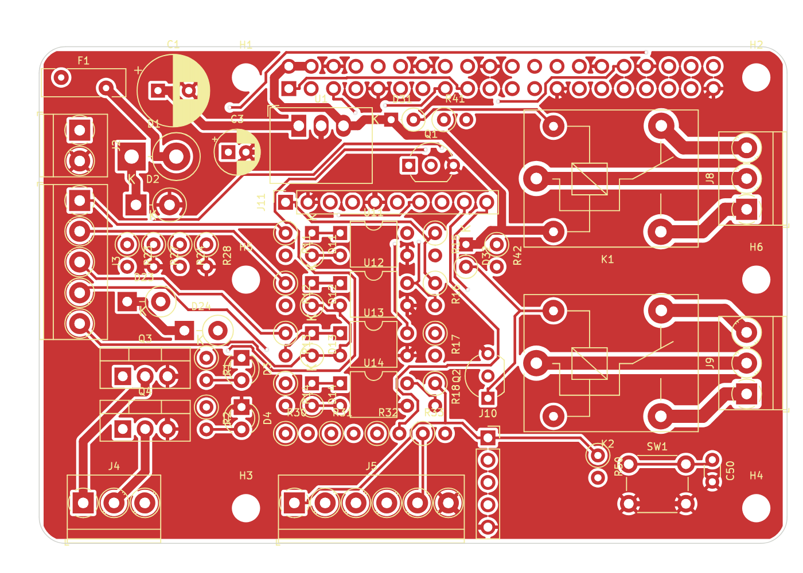
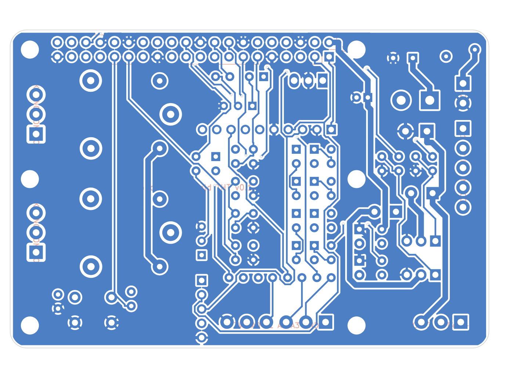

# RoboOS IoT shield THT (v0.1 - first draft)

**English** | [Slovensky](README.sk.md)

The **hand-solderable** variant of the [IoT shield](../iot-shield/README.md): through-hole parts only, so it can be
built at home with an ordinary soldering iron. Same GPIOs as the SMD shield, so the same RoboOS setup
(`alarm`, MQTT, BASIC, the JSON API) works on both.

**Status: drawn and routed (Freerouting, 300 passes), not manufactured, not tested.** KiCad DRC: every net
connected, no clearance errors (only silkscreen warnings). Check everything before ordering.

| top | bottom (seen from below) |
|---|---|
|  |  |

Schematic: [iot-shield-tht-schematic.pdf](iot-shield-tht-schematic.pdf) (KiCad 7: `iot-shield-tht.kicad_sch`,
`iot-shield-tht.kicad_pcb`). Shopping list: [parts.csv](parts.csv).

## Size and mounting

85 x 56.5 mm (the size of a Pi 3): the HAT outline plus 20 mm that hang over the Pi's **SD card end**
(no connectors there). Mounting holes:

- H1-H4: Raspberry Pi 3 / 4 pattern, 58 x 49 mm
- H1, H2, H5, H6: Raspberry Pi **Zero / Zero 2 W** pattern, 58 x 23 mm

The 40-pin socket J1 (2x20 female, 8.5 mm) goes on the **bottom** side, everything else on top.
Cut the leads short on the bottom (the Pi's HDMI and audio jack sit under the board, 11 mm spacers).

## What is on it

| Block | Parts | RoboOS |
|---|---|---|
| Power 12-24 V | terminal J2, PTC fuse 2 A (RXEF200), 1N5822 reverse diode, TVS P6KE30CA, 5 V 2 A switching module R-78B5.0-2.0 (or TRACO TSR 2-2450, Mornsun K7805-2000R3 - same pins) to header pins 2+4 | - |
| 4 isolated inputs | J3 IN1-IN4 + COM, PC817 (DIP-4), 3.3 k, 1N4148 (5-24 V, ~7 mA at 24 V) | GPIO17, 27, 22, 5 - **low** = voltage on the input |
| 2 relays | K1/K2 SRD-05VDC-SL-C, BC337 drivers, 1N4148; contacts on J8/J9 (NO COM NC, pin 1 at the bottom) | GPIO24 (K1), GPIO25 (K2) - high = on |
| 2 MOSFET outputs | J4 OUT3 OUT4 V+, IRLZ44N (logic level) low side, 1N5819 flyback diodes | GPIO12 (PWM), GPIO16 - high = on |
| Analog | J5: 3V3, A0-A3, GND -> 1 k -> socket J11 for the common **ADS1115 module** (0x48) | `sensors`, MQTT `a0`-`a3`, BASIC `SENSOR(4..7)` |
| Clock | socket J10 for the small **DS3231 "RTC for Raspberry Pi" module** (0x68, CR1220 on the module) | the time at boot without a network |
| Button | SW1 6x6 mm, 10 k pull-up + 100 n | GPIO6 - **low** = pressed |
| LEDs | red D3 = 5 V (power), green D4 = GPIO23 (status) | `gpio 23 hi` |

## Things to know

- Relay contacts: **low voltage only** (max 24 V, 5 A) - the board has no 230 V creepage distances.
- 5 V reaches the Pi through header pins 2 and 4. **Do not plug the Pi's USB power in at the same time.**
- Input range 12-24 V, absolute max about 28 V (TVS standoff 25.6 V, R-78B 32 V).
- The polyfuse (2 A) covers the Pi, the relays and the MOSFET loads together.
- Analog inputs: 0-3.3 V only.
- Modules: the ADS1115 module sits **over the inputs** (only low parts there), the DS3231 module bottom right.
  The ADS1115 module's ADDR pin is tied to GND (address 0x48).
- The analog filter capacitors, relay LEDs and the separate 100 n caps of the SMD shield were left out to make room.

## Routing and rebuilding

Same tools as the SMD shield: `circuit.py` (parts + nets) -> `gen_sch.py` (schematic) -> `check_net.py`
(netlist == circuit.py) -> `gen_pcb.py` (placement from `place.py`) -> `route.py` (Freerouting 1.9.0 under
`xvfb-run`, own SES reader, GND planes) -> `bom.py` (parts.csv).

```
./make.sh /path/to/freerouting.jar 150     # everything, routed
```

Ordering the bare board: `iot-shield-tht-gerbers.zip` (Gerbers + drill), any PCB maker, 2 layers, 1.6 mm.
