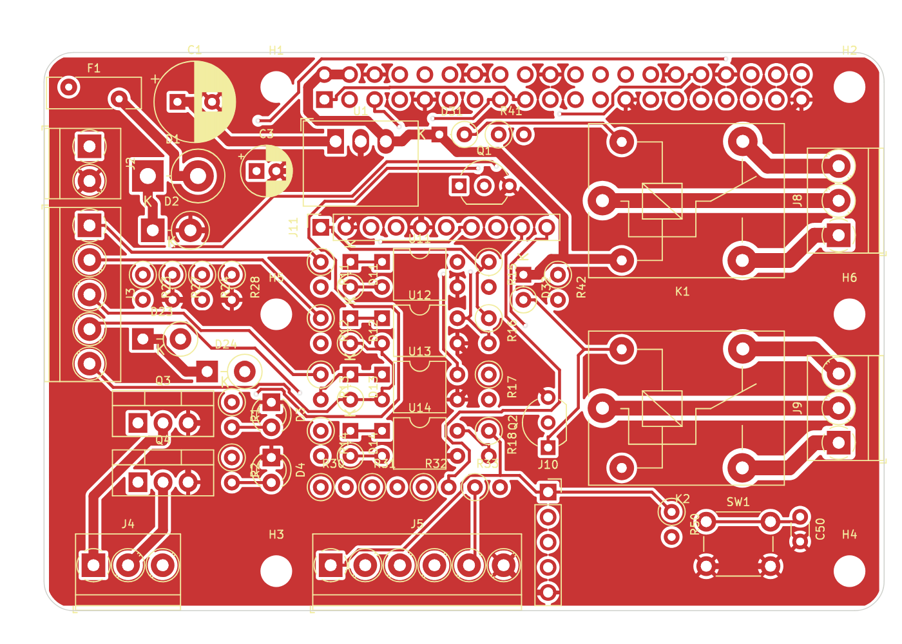
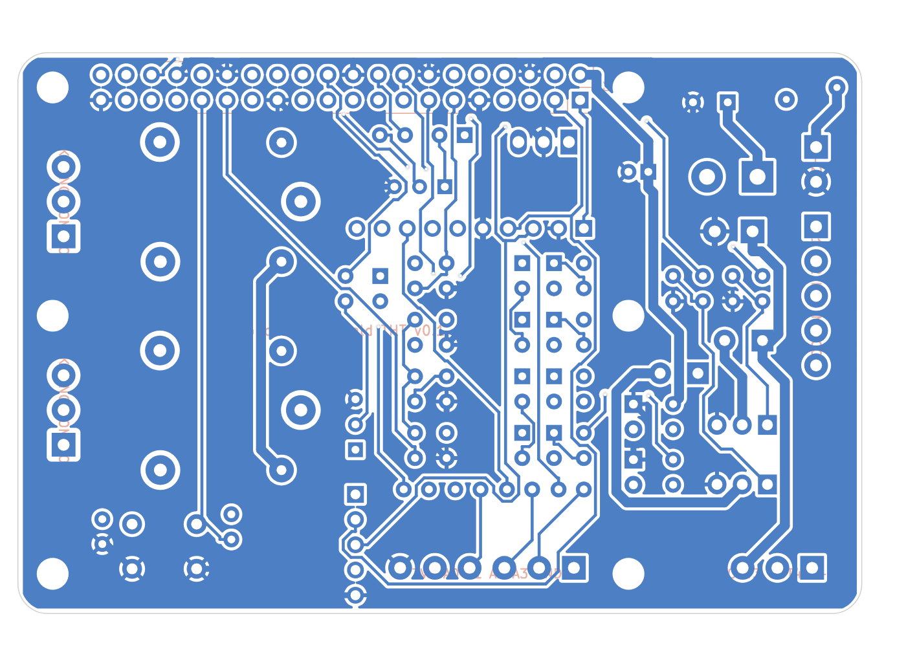

# RoboOS IoT shield THT (v0.1 - prvý návrh)

[English](README.md) | **Slovensky**

Verzia [IoT shieldu](../iot-shield/README.sk.md) **na spájkovanie doma**: len vývodové (THT) súčiastky, stačí
obyčajná spájkovačka. GPIO sú rovnaké ako na SMD doske, takže to isté nastavenie RoboOS (`alarm`, MQTT, BASIC,
JSON API) funguje na oboch.

**Stav: nakreslená a natiahnutá (Freerouting), nevyrobená, neodskúšaná.** Pred objednaním všetko skontroluj.

| vrch | spodok (pohľad zdola) |
|---|---|
|  |  |

Schéma: [iot-shield-tht-schematic.pdf](iot-shield-tht-schematic.pdf) (KiCad 7: `iot-shield-tht.kicad_sch`,
`iot-shield-tht.kicad_pcb`). Nákupný zoznam: [parts.csv](parts.csv).

## Rozmer a uchytenie

85 x 56,5 mm (veľkosť Pi 3): obrys HAT + 20 mm, ktoré prečnievajú nad koncom Pi so **SD kartou**
(tam nie sú konektory). Montážne otvory:

- H1-H4: rozostup Raspberry Pi 3 / 4, 58 x 49 mm
- H1, H2, H5, H6: rozostup Raspberry Pi **Zero / Zero 2 W**, 58 x 23 mm

40-pinová dutinková lišta J1 (2x20, 8,5 mm) ide na **spodnú** stranu, všetko ostatné hore.
Vývody zospodu skráť nakrátko (pod doskou je HDMI a jack Pi, stĺpiky 11 mm).

## Čo na nej je

| Blok | Súčiastky | RoboOS |
|---|---|---|
| Napájanie 12-24 V | svorkovnica J2, PTC poistka 2 A (RXEF200), dióda 1N5822 proti prepólovaniu, TVS P6KE30CA, spínaný modul 5 V 2 A R-78B5.0-2.0 (alebo TRACO TSR 2-2450, Mornsun K7805-2000R3 - rovnaké piny) na piny 2+4 | - |
| 4 izolované vstupy | J3 IN1-IN4 + COM, PC817 (DIP-4), 3,3 k, 1N4148 (5-24 V, ~7 mA pri 24 V) | GPIO17, 27, 22, 5 - **nízka** = na vstupe je napätie |
| 2 relé | K1/K2 SRD-05VDC-SL-C, tranzistory BC337, 1N4148; kontakty na J8/J9 (NO COM NC, pin 1 dole) | GPIO24 (K1), GPIO25 (K2) - vysoká = zopnuté |
| 2 výstupy MOSFET | J4 OUT3 OUT4 V+, IRLZ44N (logic level) na zem, ochranné diódy 1N5819 | GPIO12 (PWM), GPIO16 - vysoká = zapnuté |
| Analóg | J5: 3V3, A0-A3, GND -> 1 k -> dutinky J11 pre bežný **modul ADS1115** (0x48) | `sensors`, MQTT `a0`-`a3`, BASIC `SENSOR(4..7)` |
| Hodiny | dutinky J10 pre malý **modul DS3231 "RTC pre Raspberry Pi"** (0x68, CR1220 na module) | čas pri štarte aj bez siete |
| Tlačidlo | SW1 6x6 mm, pull-up 10 k + 100 n | GPIO6 - **nízka** = stlačené |
| LED | červená D3 = 5 V (napájanie), zelená D4 = GPIO23 (stav) | `gpio 23 hi` |

## Treba vedieť

- Kontakty relé: **len malé napätie** (max 24 V, 5 A) - doska nemá izolačné vzdialenosti pre 230 V.
- 5 V ide do Pi cez piny 2 a 4. **Nezapájaj súčasne USB napájanie Pi.**
- Vstupné napätie 12-24 V, absolútne maximum asi 28 V (TVS 25,6 V, R-78B 32 V).
- Poistka 2 A kryje spolu Pi, relé aj záťaže na MOSFEToch.
- Analógové vstupy len 0-3,3 V.
- Moduly: ADS1115 sedí **nad vstupmi** (sú tam len nízke súčiastky), DS3231 vpravo dole.
  Pin ADDR modulu ADS1115 je na GND (adresa 0x48).
- Kvôli miestu vypadli oproti SMD doske filtre analógových vstupov, LED pri relé a samostatné 100 n kondenzátory.

## Spoje a opätovné vygenerovanie

Rovnaké nástroje ako pri SMD doske: `circuit.py` (súčiastky + spoje) -> `gen_sch.py` (schéma) -> `check_net.py`
(netlist == circuit.py) -> `gen_pcb.py` (rozmiestnenie z `place.py`) -> `route.py` (Freerouting 1.9.0 pod
`xvfb-run`, vlastné čítanie SES, GND plochy) -> `bom.py` (parts.csv).

```
./make.sh /cesta/k/freerouting.jar 150     # všetko, aj so spojmi
```

Objednanie holej dosky: `iot-shield-tht-gerbers.zip` (Gerbery + vŕtanie), hocijaký výrobca, 2 vrstvy, 1,6 mm.
