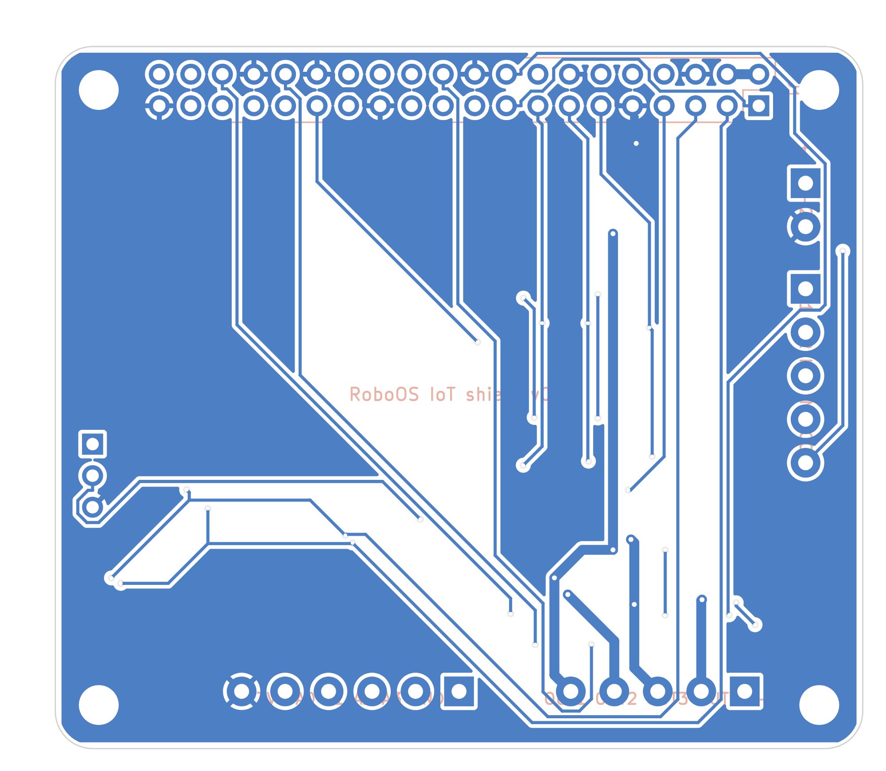

# RoboOS IoT shield (v0.1 - first draft)

**English** | [Slovensky](README.sk.md)

A board for the 40-pin header of a Raspberry Pi 3 (HAT size, 65 x 56.5 mm) that turns
it into a small IoT / automation controller for RoboOS.

**Status: drawn and routed (Freerouting), not manufactured, not tested.** KiCad DRC: no clearance
errors, every net connected (only silkscreen warnings). Check everything before ordering.

| top | bottom (seen from below) |
|---|---|
|  |  |

Schematic: [iot-shield-schematic.pdf](iot-shield-schematic.pdf) (KiCad 7: `iot-shield.kicad_sch`, `iot-shield.kicad_pcb`).

## What is on it

| Block | Parts | RoboOS |
|---|---|---|
| Power 12-24 V | terminal J2, polyfuse 2 A, SS34 reverse diode, TVS SMBJ26CA, buck AP63205 (5 V 2 A) to header pins 2+4 | - |
| 4 isolated inputs | J3 IN1-IN4 + COM, PC817, 3.3 k (5-24 V, about 7 mA at 24 V) | GPIO17, 27, 22, 5 - **low** = voltage on the input |
| 4 outputs | J4 OUT1-OUT4 + V+, AO3400A low side, B5819W flyback diodes | GPIO24, 25, 12 (PWM), 16 - high = on |
| Analog | J5: 3V3, A0-A3, GND; ADS1115 at 0x48, 1 k + 100 n filter per input | `sensors`, MQTT `a0`-`a3`, BASIC `SENSOR(4..7)` |
| Climate | BME280 at 0x76 (on the board edge, away from the regulator) | `sensors`, MQTT `temp`/`hum`/`press` |
| Clock | DS3231MZ at 0x68 + CR1220 | the time at boot without a network |
| 1-Wire | J6 3V3 / DQ / GND, 4.7 k pull-up | GPIO4 (DS18B20 - no RoboOS driver yet) |
| Qwiic / STEMMA QT | J7, 3.3 V I2C | `i2c scan` |
| LEDs | green = 5 V, red = GPIO23 (status) | `gpio 23 hi` |

Connect a load (relay coil, LED strip, valve) between **V+** and **OUTx**. Inputs: put the
signal between **INx** and **COM** (COM is isolated from the Pi ground).

## Things to know

- 5 V reaches the Pi through header pins 2 and 4 (back-powering). **Do not plug the Pi's USB
  power in at the same time.** The official HAT spec wants an ideal diode here - not in v0.1.
- Input range 12-24 V, absolute max about 28 V (TVS standoff 26 V, regulator 32 V).
- Output current: the polyfuse (2 A) covers the Pi and the loads together.
- Analog inputs: 0-3.3 V only. The ADC range is +-4.096 V but its inputs must not go above VDD.
- The header socket J1 (2x20, female, 8.5 mm) goes on the **bottom** side; everything else on top.
- `bom.csv` was checked in JLCPCB's BOM tool: D2 (SMBJ26CA), F1 (2 A hold, 30 V), J7 (side-entry Qwiic),
  L1 (5x5 mm), R11-R14 (1206), D3 and U4 (DS3231MZ+TRL C107410; C9867 was a DS1337) were fixed with LCSC numbers looked up on lcsc.com / jlcpcb.com.
  **U3 (BME280), C40 and BT1 are not assembled**: plug a Qwiic BME280 module into J7 (the board warms U3); solder a
  Keystone 3000 CR1220 holder by hand (JLCPCB's match did not fit). J1 (bottom), J2-J6 = through-hole, by hand. Terminal blocks: any 3.5 mm pitch, 2/5/5/6 pins.

## Routing

The tracks were made by [Freerouting](https://github.com/freerouting/freerouting) 1.9.0:
`./make.sh /path/to/freerouting.jar` places the parts (`gen_pcb.py`), exports `build/board.dsn`,
runs Freerouting (under `xvfb-run` when there is no screen; 250 passes take ~15 min), reads the
session back (`route.py` has its own SES reader - KiCad 7's needs the editor), adds the GND planes
on both sides, fills them and writes `build/drc.txt`. GND is routed as tracks too, so the board
works even where the planes break into islands.

Net classes: "Power" (VIN, +5V, SW, OUTx) 0.8 mm, "Ground" 0.4 mm, signals 0.25 mm; vias 0.8/0.4
and 0.6/0.3 mm. Fits JLCPCB's standard 2-layer process.

Ordering: `iot-shield-gerbers.zip` (Gerbers + drill) for the bare board; for assembly also
`bom.csv` and `cpl.csv` (check the part rotations in JLCPCB's preview). J1 (40-pin socket) goes
on the bottom side - solder it yourself or order bottom assembly.

## Rebuilding

Everything is generated from `circuit.py` (one list of parts + nets):

```
sudo apt install kicad kicad-symbols kicad-footprints    # KiCad 7
./make.sh             # schematic + netlist check + board + PDF + BOM/CPL + pictures
```

`check_net.py` compares the schematic's netlist with `circuit.py` (it must say "48 of 48").
`./make.sh` without the jar rebuilds an UNROUTED board - give it the jar to route again.
