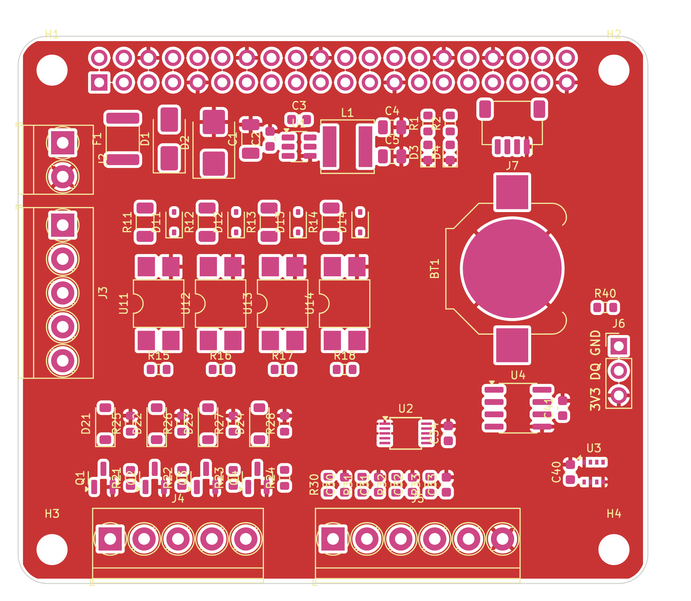

# RoboOS IoT shield (v0.1 - prvý návrh)

[English](README.md) | **Slovensky**

Doska na 40-pinový konektor Raspberry Pi 3 (veľkosť HAT, 65 x 56,5 mm), z ktorej je malý
IoT / automatizačný ovládač pre RoboOS.

**Stav: nakreslená, nevyrobená, neotestovaná. Súčiastky sú rozmiestnené, ale spoje ešte NIE sú
natiahnuté** (pozri "Routovanie"). Pred objednaním všetko skontroluj.



Schéma: [iot-shield-schematic.pdf](iot-shield-schematic.pdf) (KiCad 7: `iot-shield.kicad_sch`, `iot-shield.kicad_pcb`).

## Čo na nej je

| Blok | Súčiastky | RoboOS |
|---|---|---|
| Napájanie 12-24 V | svorka J2, polyfuse 2 A, dióda SS34 proti prepólovaniu, TVS SMBJ26CA, menič AP63205 (5 V 2 A) na piny 2+4 | - |
| 4 izolované vstupy | J3 IN1-IN4 + COM, PC817, 3,3 k (5-24 V, asi 7 mA pri 24 V) | GPIO17, 27, 22, 5 - **nula** = na vstupe je napätie |
| 4 výstupy | J4 OUT1-OUT4 + V+, AO3400A na zem, ochranné diódy B5819W | GPIO24, 25, 12 (PWM), 16 - jednotka = zapnuté |
| Analóg | J5: 3V3, A0-A3, GND; ADS1115 na 0x48, filter 1 k + 100 n na vstup | `sensors`, MQTT `a0`-`a3`, BASIC `SENSOR(4..7)` |
| Klíma | BME280 na 0x76 (pri okraji, ďalej od meniča) | `sensors`, MQTT `temp`/`hum`/`press` |
| Hodiny | DS3231MZ na 0x68 + CR1220 | čas po štarte aj bez siete |
| 1-Wire | J6 3V3 / DQ / GND, pull-up 4,7 k | GPIO4 (DS18B20 - ovládač v RoboOS ešte nie je) |
| Qwiic / STEMMA QT | J7, I2C 3,3 V | `i2c scan` |
| LED | zelená = 5 V, červená = GPIO23 (stav) | `gpio 23 hi` |

Záťaž (cievka relé, LED pás, ventil) zapoj medzi **V+** a **OUTx**. Vstupy: signál medzi
**INx** a **COM** (COM je oddelený od zeme Pi).

## Treba vedieť

- 5 V ide do Pi cez piny 2 a 4 (napájanie spätne cez konektor). **Nezapájaj súčasne USB napájanie Pi.**
  Oficiálna HAT špecifikácia chce ideálnu diódu - vo v0.1 nie je.
- Vstupné napätie 12-24 V, absolútne maximum asi 28 V (TVS 26 V, menič 32 V).
- Prúd výstupov: polyfuse 2 A kryje Pi aj záťaže spolu.
- Analógové vstupy len 0-3,3 V (rozsah ADC je +-4,096 V, ale vstup nesmie byť nad VDD).
- Konektor J1 (2x20 dutinky, 8,5 mm) ide na **spodnú** stranu, všetko ostatné hore.
- Čísla LCSC v `bom.csv` sú písané spamäti: **každé over** (hodnota, puzdro, sklad) v zozname
  súčiastok JLCPCB pred objednaním. Svorkovnice: hocijaké s roztečou 3,5 mm, 2/5/5/6 pinov.

## Routovanie

`gen_pcb.py` rozmiestni súčiastky a dá GND plochy na obe strany; spoje ešte nie sú nakreslené. Dve cesty:
1. ručne v KiCade 7 (otvor `iot-shield.kicad_pcb`, "gumičky" ukazujú každý spoj), alebo
2. Freerouting: `./make.sh /cesta/k/freerouting.jar` vyexportuje `build/board.dsn`, spustí
   Freerouting a načíta výsledok späť (`route.py`), potom vyleje plochy a zapíše `build/drc.txt`.

Napájacie siete (VIN, +5V, GND, SW, OUTx) sú v triede "Power" (spoje 0,8 mm).

## Opätovné vygenerovanie

Všetko vzniká z `circuit.py` (jeden zoznam súčiastok a sietí):

```
sudo apt install kicad kicad-symbols kicad-footprints    # KiCad 7
./make.sh             # schéma + kontrola netlistu + doska + PDF + BOM/CPL + obrázky
```

`check_net.py` porovná netlist schémy s `circuit.py` (musí napísať "48 of 48").
